# If I Disappear

**When a parent leaves Sri Lanka to work abroad, the house still has to run.** If I Disappear turns one walk through the house, explained out loud in Sinhala or English, into checked, bilingual handover steps, and proves, before the parent leaves, that someone at home can really do each job.

[](docs/HACKATHON.md)
[](#theme-1-build-for-your-world)
[](#metas-models-and-what-they-do-together)
[](#proof-it-works)
[](#sinhala-speech)
[](LICENSE)

*Meta Global AI Developer Hackathon 2026 · Indie track · Theme 1, Build for Your World · by Nipun Dilshan Senevirathne*

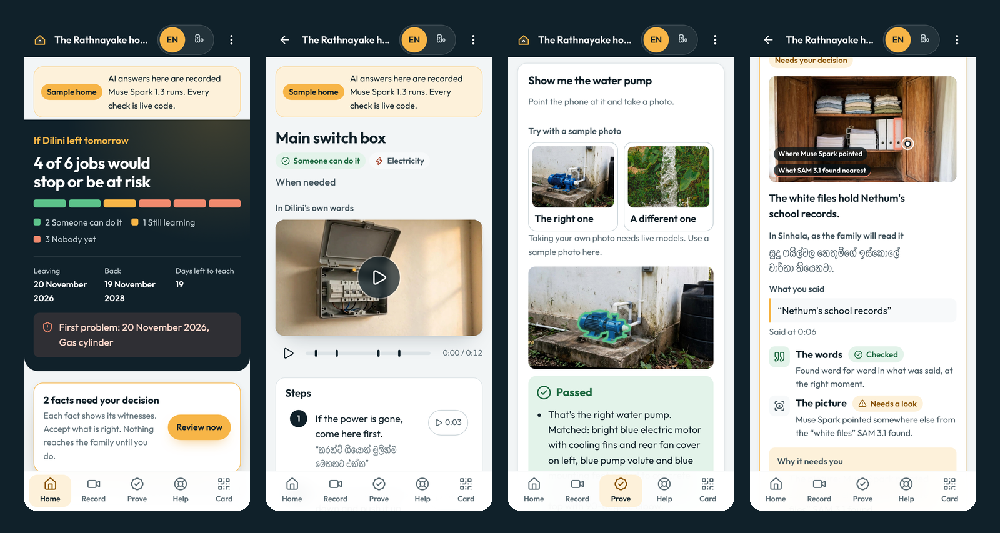

<!-- Add the demo video's link beside these once it is uploaded. -->
**[Try the sample home, live](https://nipun-dilshan-if-i-disappear.hf.space/try)** · **[The five-minute tour for judges](docs/JUDGES.md)** · **[A 90-second recording of the app](docs/demo/if-i-disappear-demo.mp4)** · **[Every diagram](docs/diagrams/README.md)**

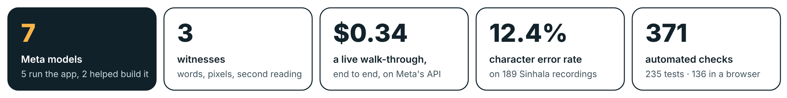

**Contents:** [In thirty seconds](#in-thirty-seconds) · [The rubric and the evidence](#for-the-judges-the-rubric-and-the-evidence) · [The problem](#the-problem) · [Who it helps](#who-it-helps) · [What it does](#what-it-does) · [How it works](#how-it-works) · [Meta's models](#metas-models-and-what-they-do-together) · [What surprised us](#what-surprised-us) · [Engineering](#engineering) · [Proof it works](#proof-it-works) · [Try it](#try-it) · [Privacy](#privacy-and-safety) · [Run it yourself](#run-it-yourself) · [Documents](#repository-and-documents)

## In thirty seconds

**The problem.** 310,915 Sri Lankans left for work abroad in 2025, about 850 a day. Each leaves a home that still has to run, and what keeps it running (the main switch in a power cut, the water pump, the gas, the bills, the deeds, the school pickup) usually lives in one person's head. It gets handed over in a rush, from memory, and nobody knows who can really do what until something breaks.

**What it does.** The person leaving films the house once, explaining it. Meta's models turn that into small facts with the exact words said and the object on screen; up to three witnesses check every fact; each person staying proves each job before the departure; a help line answers only with what was recorded.

**Meta's models.** Seven, each doing what it does best; the three that read the house check each other's work. Muse Spark's point on a frame must land inside SAM 3.1's outline of the same object. Muse Wonder re-reads every electricity, gas and fire fact. SAM 3.1 tracks the object through the video from Muse Spark's own point. Omnilingual ASR, Meta's open weights, hears Sinhala, which Meta's hosted speech model doesn't.

**Proof it works.** The whole web app ran live on Meta's Model API, the way a family uses it, once in English and once in Sinhala: a six-room walk-through recorded, a bank card on a shelf found and blurred, a spoken gate code hidden and silenced, a medicine sentence refused, the facts reviewed, jobs proven by photo and by voice, the help line, stickers, offline, and the home deleted. **76 of 76 checks in each**, for about fifty cents a run. On the hosted copy, after the last fix: **74 of 75** (the one miss was the test machine's network dropping a download). Plus 371 automated checks, an evaluation on two Meta models (run twice, every failure kept), held-out sets frozen before they ran, and Sinhala speech measured on 189 real recordings.

## : the rubric and the evidence

| Criterion | What If I Disappear does for it | Where to see it |
|---|---|---|
| **Impact** (30%) | A large, specific, real problem from the builder's own country, the one Theme 1 asks for. Built for the people who live it: Sinhala as a first language, large type for grandparents, works offline, QR stickers on the objects, WhatsApp for people who won't install an app. Cheap enough to give away: $0.34 for a whole live walk-through. | [The problem](#the-problem) · [Who it helps](#who-it-helps) · [A family's journey](#what-it-does) |
| **Use of Meta AI tooling** (25%) | Seven Meta models, each used for what it is best at, wired so that they check each other: two models that never see each other's answer must agree on pixels; a second model may only uphold or flag; SAM 3.1 tracks through video from Muse Spark's point; Sinhala comes from Meta's open-weights Omnilingual ASR, self-hosted and measured. Every surprise, good and bad, is written down with what it changed. | [Meta's models](#metas-models-and-what-they-do-together) · [What surprised us](#what-surprised-us) · [MODELS.md](docs/MODELS.md) |
| **Technical depth and execution** (20%) | Models read, code decides: three witnesses and a rule file pinned by SHA-256, a hash-chained event log read by a pure function, three-valued coverage, a day-by-day simulation of the absence, an exact 0/1-knapsack teaching plan, a fenced tool-calling agent, signed scoped links, spending caps that hold across threads and processes, recordings sent in resumable pieces, slow model work kept off the server's event loop, uploads ffmpeg can only open as audio or video. 230 backend tests, 5 service tests, 136 browser checks. | [How it works](#how-it-works) · [Engineering](#engineering) · [ARCHITECTURE.md](docs/ARCHITECTURE.md) |
| **Demo** (25%) | A sample home that runs with no key and no sign-up: every model output in it is a real recorded run of Meta's models, and every check and decision runs live as you click. The whole web app run live on Meta's API, in English and in Sinhala, by a script anyone with a key can rerun: 76 of 76 checks each, and 74 of 75 on the hosted copy. A three-minute video script written for judges watching live. | [Try it](#try-it) · [JUDGES.md](docs/JUDGES.md) · [The hosted runs](docs/EVALUATION.md#the-hosted-copy-1-november) · [Video script](docs/HACKATHON.md#demo-video-script) |

## The problem

310,915 Sri Lankans left the country for work abroad in 2025, after a record 314,672 in 2024, and the government's target for 2026 is 350,000. They sent home about US$7.8 billion in 2025, more than in any year before ([Sri Lanka Bureau of Foreign Employment figures, Daily Mirror, 6 January 2026](https://www.dailymirror.lk/breaking-news/Sri-Lanka-eyes-350-000-foreign-employment-departures-in-2026/108-329575)). Seven in ten went to Kuwait, the UAE, Qatar or Saudi Arabia, and in the first eight months of 2025 almost four in ten of them were women: 82,050 of 212,302 ([Daily Mirror](https://www.dailymirror.lk/news/Over-212-000-Sri-Lankans-depart-for-foreign-jobs-in-first-eight-months/239-318967)).

Every one of them leaves a home that still has to run: the main switch when the power goes, the water pump, the gas cylinder, the electricity bill, the deeds in the cupboard, the Wednesday school pickup. That knowledge usually lives in one person's head. It gets handed over in the last week before a flight, half in Sinhala and half in English, from memory, in voice notes nobody can search at eleven at night in a power cut. Nobody checks it, and nobody finds out who can't actually do a job until the day it is needed. Then the person who left becomes the house's help line, from thousands of kilometres away.

From 2013 to 2022 Sri Lanka required women with children to name a substitute caregiver before they could leave for work abroad, the Family Background Report ([HELVETAS policy brief, 2017](https://www.helvetas.org/Publications-PDFs/Asia/Sri-Lanka/HELVETAS%20Policy%20Brief%20%E2%80%9CThe%20FBR%20Raising%20or%20Lowering%20the%20Social%20Costs%20of%20Labour%20Migration%E2%80%9D%20%28October%202017%29.pdf)). The rule was dropped in 2022, partly because it restricted women's rights ([Daily FT, 29 June 2022](https://www.ft.lk/news/Cabinet-approves-removal-of-mandatory-family-background-report-for-female-migrant-workers/56-736836)). The handover it was about still has to happen in every home, whoever leaves.

### Theme 1: Build for Your World

> *"Bring Meta's models into your domain. Solve a problem you know firsthand, free up time and mental space, and make something possible that wasn't before."*
> — the hackathon's [Theme 1](https://dev.meta.ai/events/global-hackathon)

- **A problem known firsthand.** Built in Sri Lanka, for Sri Lankan homes, in Sinhala and English, with Sri Lanka's emergency numbers, its bills and its family roles in mind.
- **Time and mental space.** The person leaving explains the house once, instead of on the phone from abroad for two years. The people staying stop guessing.
- **Something that wasn't possible before:** a handover you can check. Before the flight, the family knows which jobs would stop, and each person has proven to two Meta models and to code that they can do their jobs.

## Who it helps

- **The person leaving**: a mother going to domestic work in Kuwait, a father going to drive in Qatar. They explain the house once, see what would stop, and leave knowing who can do what.
- **The people staying**: a husband who has never opened the switch box, a grandmother who reads Sinhala in large type and won't install an app, a fourteen-year-old who will be the one checking the tank. Everything is in Sinhala and English, works offline, opens from a QR sticker and answers on WhatsApp.
- **Anyone at the door**: a neighbour or an electrician can scan the sticker on the switch box and see that one job, and nothing else in the home.
- **Beyond Sri Lanka**: the same handover happens in every country that sends workers abroad. The speech side runs on Omnilingual ASR, which Meta built for more than 1,600 languages, so adding Tamil, Sri Lanka's other language, means translating the interface, the privacy and medical word lists and the second-language fields, then measuring it: work, not a rewrite. The same structure fits a long hospital stay, a parent moving in with family, or a house-sitter.

## What it does

1. **Walk and talk.** The person leaving films the house on a phone and explains it, in Sinhala or English: *"මේ තියෙන්නේ ප්‍රධාන ස්විච් පෙට්ටිය. කරන්ට් ගියොත් මුලින්ම මෙතනට එන්න."* ("This is the main switch box. If the power goes, come here first.")
2. **Read.** Muse Spark 1.3 turns what was said into small facts (where things are, steps, warnings, schedules, contacts, bills), each with the exact words said, the second they were said, and a point on the video frame.
3. **Check, three ways.** Code finds every quote word for word. SAM 3.1 outlines the object, and Muse Spark's point has to fall inside the outline. Muse Wonder 1.0 re-reads every electricity, gas and fire fact. Rules no model can change decide; then the owner accepts or rejects each fact.
4. **Prove.** Each person staying proves each job: a photo of the object (SAM 3.1 finds it, Muse Spark compares it with the owner's) and an explanation in their own words (checked point by point; every safety point must be there). A safety job needs both.
5. **See what would stop.** The board answers *"if I left tomorrow, what would stop?"*, simulates every day of the absence, plans the lessons for the days before the departure, and asks the questions the owner forgot to answer.
6. **Help while away.** *"What do I do?"* on the web, by voice or on WhatsApp, answered only with what the owner recorded. A gas smell is an emergency, so code shows Sri Lanka's emergency numbers before any model runs.
7. **On the wall.** A fridge card, and a QR sticker for each object. A sticker opens only its own job and its clip, on any phone, with no sign-in. On a phone that saved the offline pack, it opens even with no signal, because a power cut often takes the Wi-Fi with it.


<table>
<tr>
<td width="25%">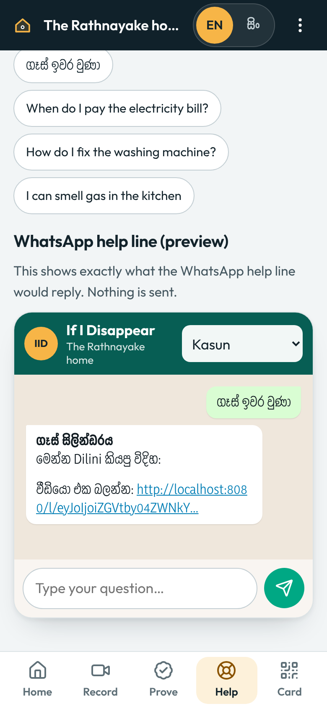</td>
<td width="25%">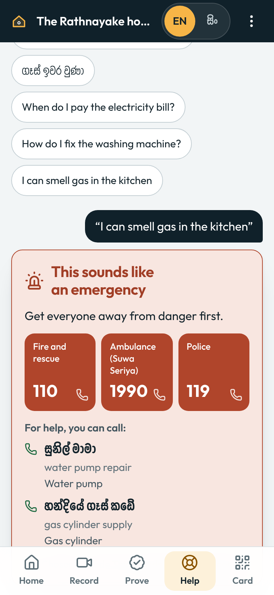</td>
<td width="25%">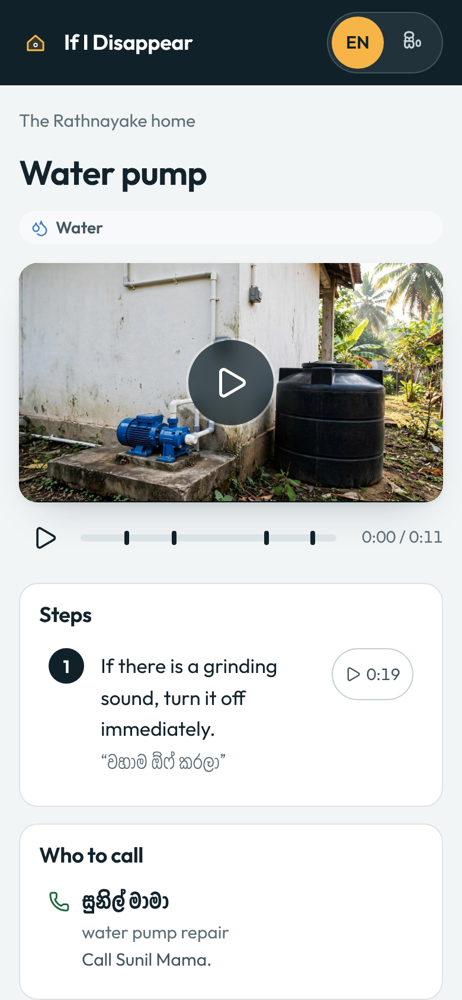</td>
<td width="25%">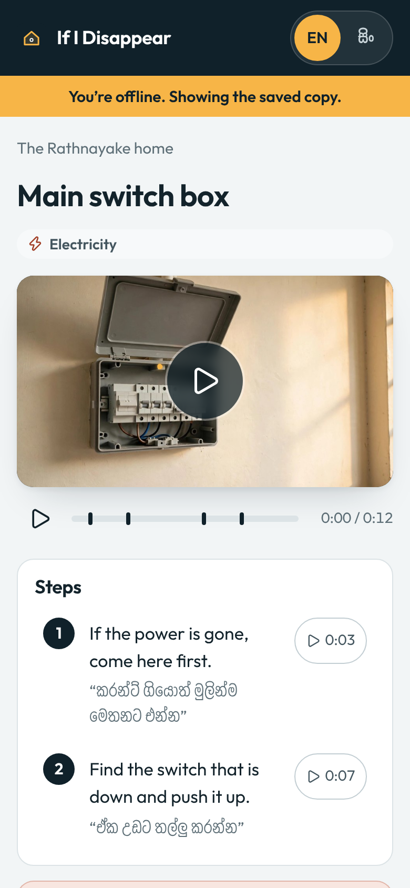</td>
</tr>
<tr>
<td><b>WhatsApp.</b> A question in Sinhala gets Dilini's recorded steps and a link to the job.</td>
<td><b>A gas smell.</b> An emergency: code shows the numbers before any model runs.</td>
<td><b>A sticker.</b> Its QR code opens that one job, its clip and who to call, nothing else.</td>
<td><b>No connection.</b> A sticker still opens its job, from the pack saved on the phone.</td>
</tr>
<tr>
<td>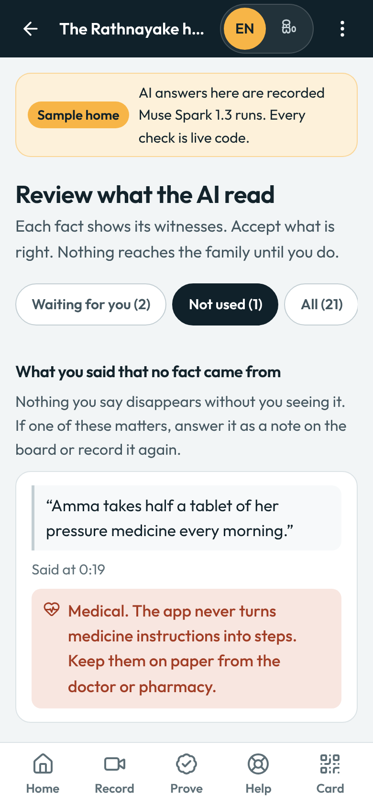</td>
<td>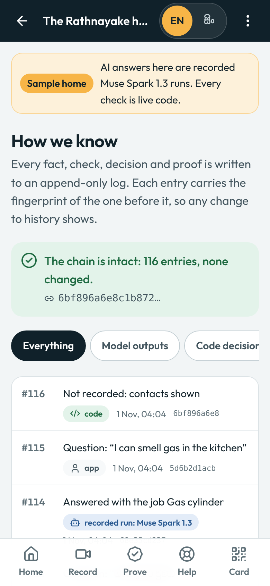</td>
<td>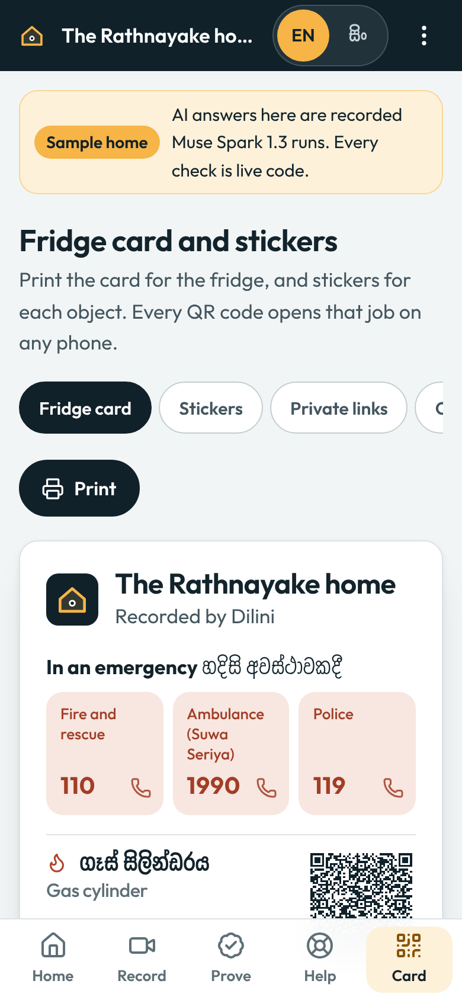</td>
<td>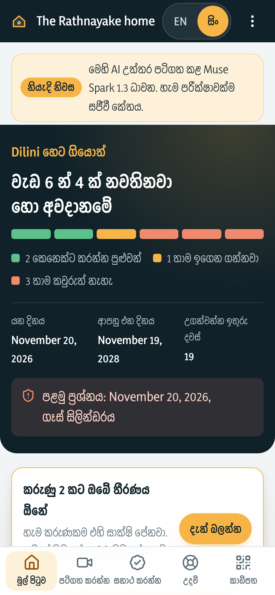</td>
</tr>
<tr>
<td><b>Not used.</b> The medicine sentence never becomes a step, and code says why.</td>
<td><b>Evidence.</b> Every model output, check and decision in a hash-chained log, checked live.</td>
<td><b>The fridge card.</b> A QR code for each job, and the emergency numbers.</td>
<td><b>සිංහල.</b> Every screen, fact and check reads in Sinhala.</td>
</tr>
</table>

## How it works

One rule runs through the whole app: **models read, code decides.** Meta's models turn video, speech and photos into structured facts and comparisons. Deterministic code checks every fact, applies rules no model can change, and computes everything the family sees. Every step is an event in a hash-chained log, so any screen can be traced back to the words, pixels and model outputs behind it.

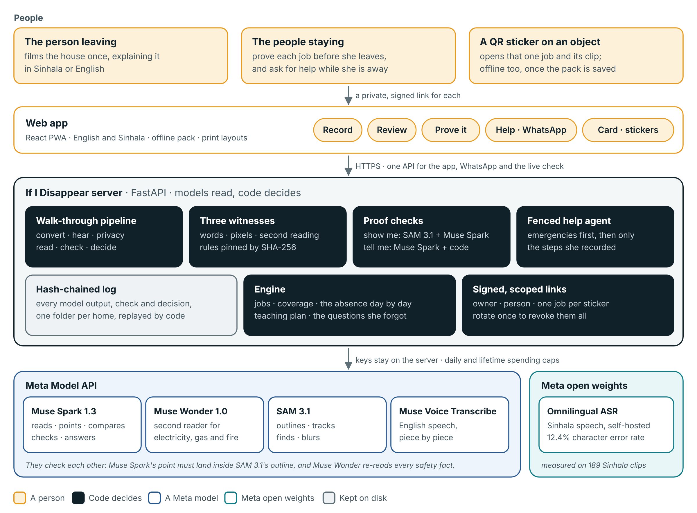

### A walk-through, step by step

Six steps, each written to the log. The times are from the last live run through the web app on Meta's API (1 November): a 71-second walk-through of six rooms took 158 seconds from upload to 18 checked facts, most of it SAM 3.1 searching the whole video for cards and Muse Spark reading at high reasoning effort.

- **Convert.** FFmpeg makes an H.264 MP4 (for phones and SAM 3.1), a 16 kHz WAV and a still every 2 seconds.
- **Hear.** The audio is cut at pauses first, so every sentence keeps its own time. English goes to Muse Voice Transcribe, four pieces at a time, with the family's names as keywords; Sinhala goes to Omnilingual ASR.
- **Privacy.** Secrets are hidden in the words and silenced in the video; SAM 3.1 searches the whole video, two frames a second, for cards, ID cards and screens, and code blurs them in the video and the stills.
- **Read.** One Muse Spark call with the turns and up to 40 stills: a strict JSON schema with no optional fields, high reasoning effort, and a prompt cache per household. Then a short Muse Spark call writes the Sinhala, used only if it is well formed.
- **Check.** The three witnesses, below, four facts at a time.
- **Decide.** The pinned rules, then the owner.

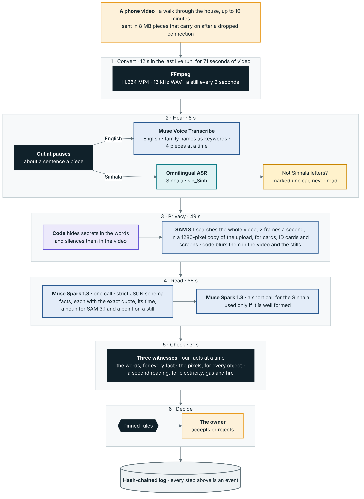

### Three witnesses

A fact reaches the family only when every witness that applies agrees and the owner accepts it.

- **The words** (code). The quote must be in its own speaking turn, word for word, near the time cited (2 seconds before to 4 after), and at least 6 characters long. A failed check shows the closest words that were really said.
- **The pixels** (SAM 3.1 and code). SAM 3.1 outlines the fact's noun on the same still, and Muse Spark's point must fall inside a mask with a confidence of at least 0.5. The two models never see each other's answer.
- **A second reading** (Muse Wonder 1.0). For electricity, gas and fire, a second model reads the fact, the owner's exact words, the whole turn, the still and SAM 3.1's box, and may only *uphold* or *flag*, with a reason in English and Sinhala.

| The fact | Must pass |
|---|---|
| Any fact | the words |
| A fact about a visible object | the words and the pixels |
| A fact about electricity, gas or fire | the words, the pixels (for an object) and a second reading |

Medical instructions are refused, in English and Sinhala, whatever the witnesses say. A Sinhala translation with letters from another script in it goes to review. These rules live in [`policy.json`](backend/app/witness/policy.json), and its SHA-256 is pinned in [`gate.py`](backend/app/witness/gate.py): if the file changes without a person updating the pin, the server refuses to start. `/rules` shows both.

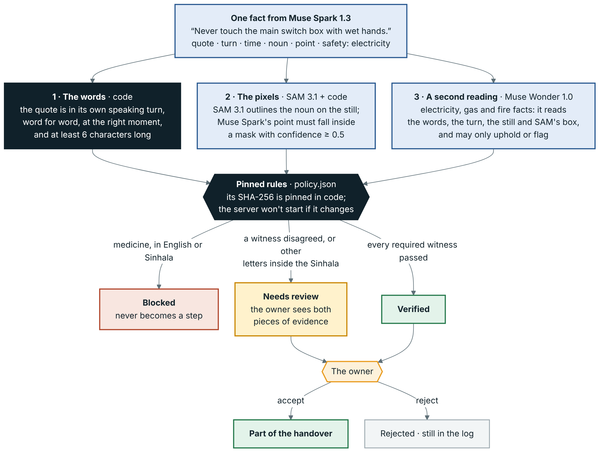

### Sinhala speech

Muse Voice Transcribe, Meta's hosted speech model, doesn't offer Sinhala, so the app runs Meta's open-weights **Omnilingual ASR** as a small service beside it ([`services/sinhala-asr`](services/sinhala-asr/README.md)). On a GPU it runs `omniASR_LLM_1B_v2`, told the language; on a CPU, `omniASR_CTC_1B_v2`, which had a 12.4% character error rate on 189 public Sinhala recordings, 3.2 times faster than real time on the build machine's 2 CPUs (on the hosted Space's basic CPU, about half real time). Two guards came from that measurement: the joiner Sinhala needs inside conjunct letters is put back where the tokenizer wrote an unknown mark, and a piece that comes back mostly in another alphabet (9 of the 189 did, in Telugu, Kannada, Malayalam or Gujarati letters) is marked unclear: no fact is read from it, and the owner sees it listed.

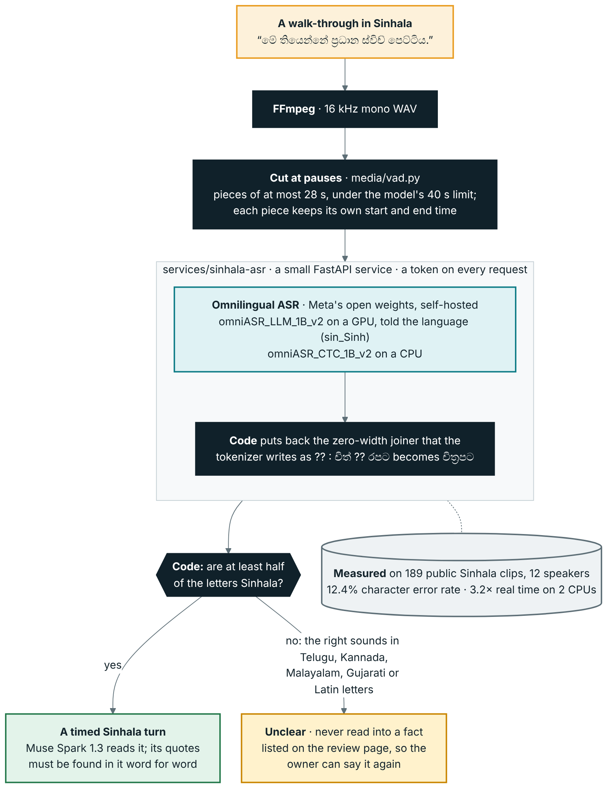

### Proving a job: show me, then tell me

- **Show me.** The person staying photographs the object. SAM 3.1 must find it (confidence 0.5 or more), code frames both photos alike around what SAM 3.1 found, and Muse Spark compares them, naming what matches and what doesn't. Code passes it only when Muse Spark says it is the same object *and* at least two concrete features match. When the model can't tell, the answer is no.
- **Tell me.** They explain the job out loud or in writing, in Sinhala, English or Singlish. Muse Spark marks each recorded point as covered or not and copies the words that cover it; code finds each copied quote in what was really said, and passes the explanation only when at least 75% of the points and every safety point are covered.

A proof lasts 120 days. A safety job needs both, from the same person.

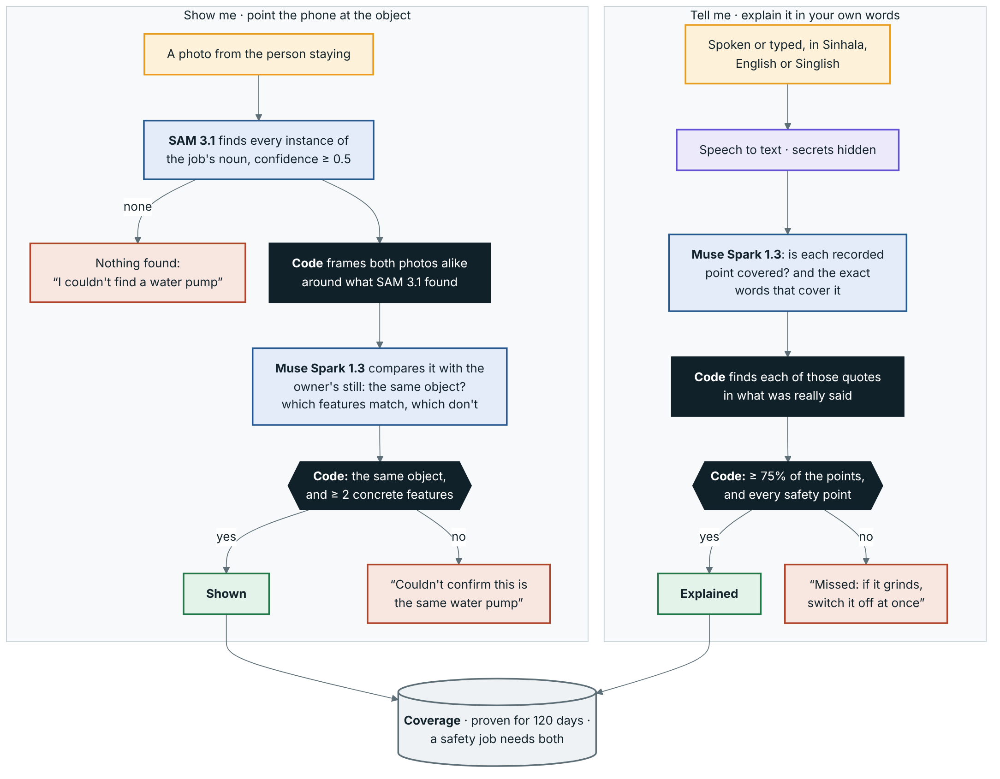

### The help line, inside a fence

Code checks for emergencies first (a gas smell, fire, smoke, a shock, in English and Sinhala) and answers them with Sri Lanka's emergency numbers (Fire and rescue 110, Ambulance 1990, Police 119) before any model runs. Otherwise Muse Spark runs a short tool loop with three tools: `search_steps` (code searching the recorded jobs), `answer_with_task` and `not_recorded`. The fence: code refuses any job the search didn't return in that conversation, and what is shown is always the owner's own recorded steps, never model text. In 80 evaluation answers on two models, the fence never let a wrong job through. The same answer goes to the web page, to a voice question and to WhatsApp.

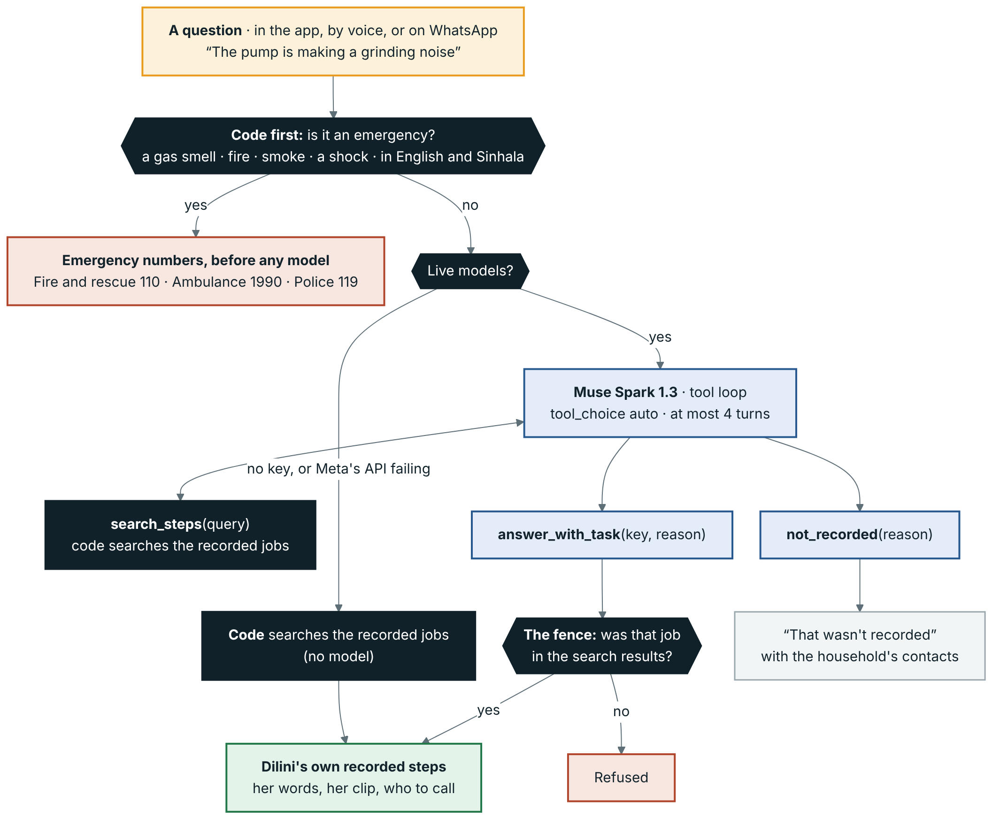

### Privacy, before anything is kept

Every transcript goes through a scrubber in English and Sinhala before it is stored or read by a model: PINs, passwords, one-time codes, gate and alarm codes, card numbers (checked with Luhn), NIC numbers and account numbers become `[hidden]`, and the piece of speech they were said in is silenced in the stored video. SAM 3.1 looks for credit cards, identity cards and phone screens on up to 12 stills, and code blurs them in the stills and the video. Medicine instructions are never turned into steps. Model output is kept nowhere but the household's own log, and **Delete this home** removes all of it.

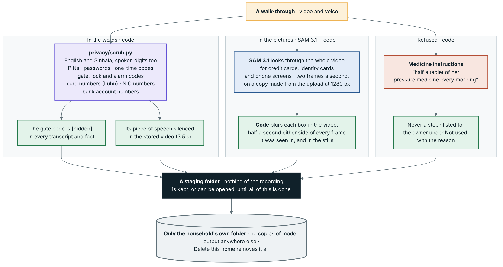

### A log anyone can check

Each household is one append-only JSON Lines file. Every event carries who wrote it (`model:muse-spark-1.3`, `model:sam-3.1`, `code`, `owner`, a person) and the SHA-256 of the event before it. Nothing is edited in place: the household is recomputed from its log by a pure function, so the same events always give the same board, and a golden test rebuilds the sample board byte for byte. The Evidence page re-verifies the whole chain on every visit.

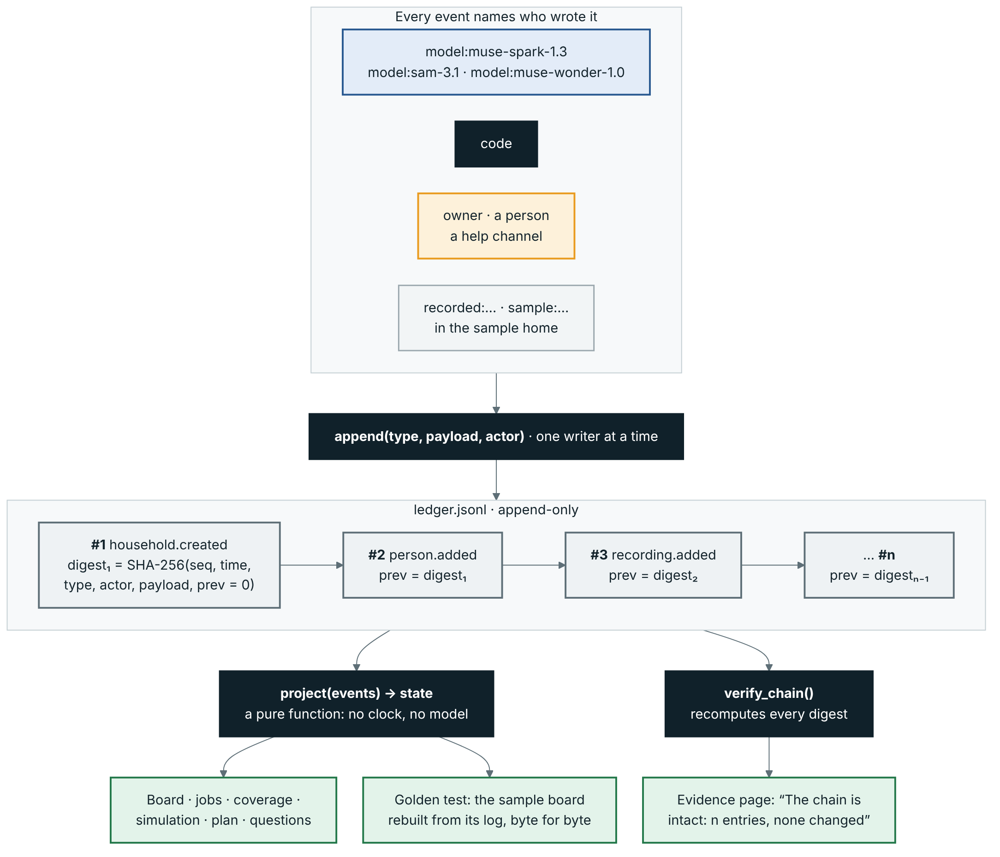

### The engine: what would stop, day by day

All of it deterministic and tested.

- **Coverage**, for each job: *yes* (someone staying has proven it), *no* (split into still learning and nobody yet), or *unknown* (not enough was recorded to prove it). Unknown is a real answer, never quietly yes or no.
- **If she left tomorrow**: how many jobs would stop.
- **The absence, day by day**: which jobs fall due each day, and whether a proven person is still proven then. A proof can run out in month five of a two-year absence; the board shows the first day something stops.
- **The teaching plan**: what to teach to whom on each day before the departure, as an exact 0/1 knapsack (dynamic programming) over 20 minutes a day, with safety and frequency as value.
- **What she forgot to say**: code knows what each kind of job needs (an appliance needs where, how, what to do if it fails, and who to call) and asks for whatever wasn't said.

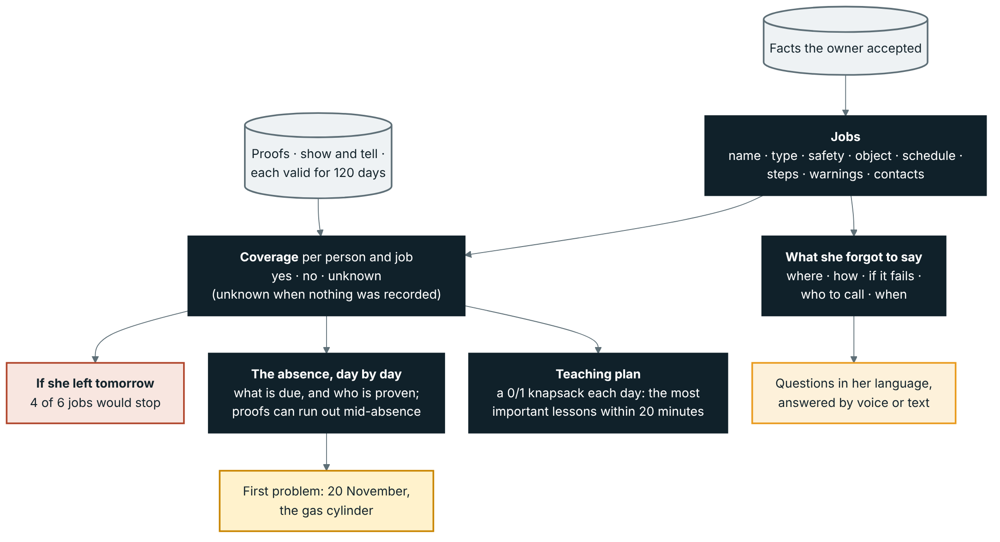

### Who can open what

No accounts and no passwords: three kinds of signed link, each with an expiry. The owner's link (400 days) can do everything; each person's link (400 days) can read the handover, prove their own jobs and ask, but sees no transcripts and edits nothing; a sticker (5 years) opens one job and its clip. Every link carries the household's link version, so one rotation revokes every old link and sticker at once.

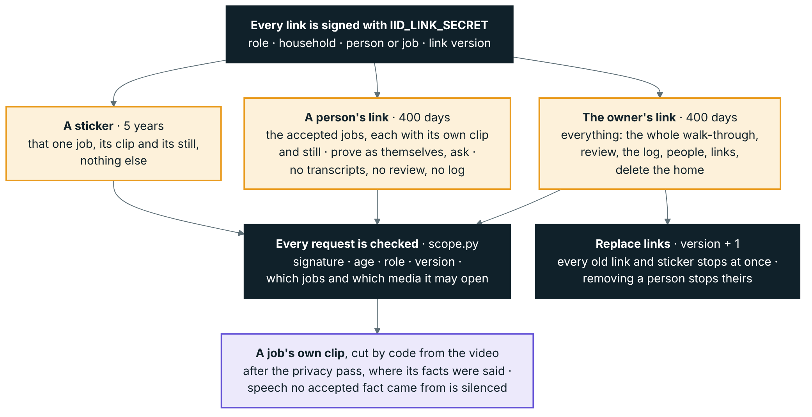

### One live walk-through, call by call

The live check on 1 November 2026, on the final code ([`scripts/live_check.py`](scripts/live_check.py), [`live_check.json`](evals/results/live_check.json)): a 48-second walk-through, made from the sample home's photos with a synthetic English voice, sent through the real server on Meta's Model API over the same HTTP API the web app uses. 85 seconds from upload to ten verified facts; 37 model calls, $0.34. The whole web app, run the same way through its own pages, is in [EVALUATION.md](docs/EVALUATION.md#the-whole-web-app-live).


## Meta's models, and what they do together

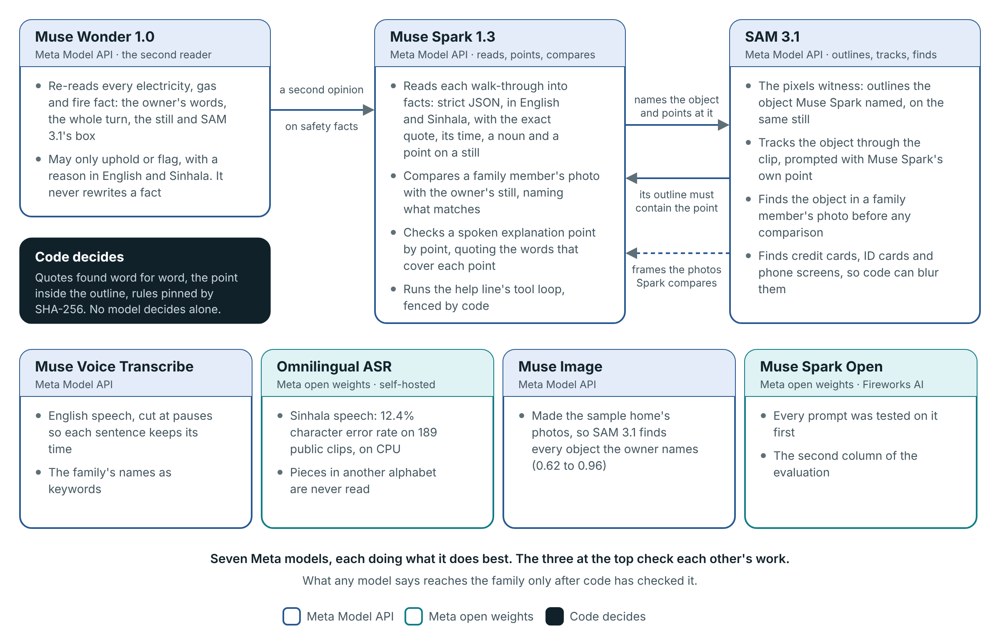

| Model | Where | What it does here |
|---|---|---|
| **Muse Spark 1.3** | Meta Model API | Reads each walk-through into facts (strict JSON, English and Sinhala); compares a family member's photo with the owner's; checks an explanation point by point; runs the help line's tool loop |
| **Muse Wonder 1.0** | Meta Model API | The second reader of every electricity, gas and fire fact. It may only uphold or flag |
| **SAM 3.1** | Meta Model API (Responses and Files APIs) | The pixels witness; tracks each object through its clip from Muse Spark's point; finds the object in a family member's photo; finds cards and screens to blur |
| **Muse Voice Transcribe** | Meta Model API | English speech, cut at pauses, with the family's names as keywords |
| **Omnilingual ASR** | Meta's open weights, self-hosted | Sinhala speech (`sin_Sinh`): 12.4% character error rate on 189 real recordings, on CPU |
| **Muse Image** | Meta Model API | Made the sample home's photos, so what the owner says matches what is in the picture. Never used on a family's handover |
| **Muse Spark Open** | Meta's open weights, on Fireworks AI | Where every prompt was first tested, and the second column of the evaluation. The app can run on it (`MODEL_PROVIDER=fireworks`), without the steps Fireworks doesn't host |

Every prompt is in [`backend/app/meta/prompts.py`](backend/app/meta/prompts.py) and every schema in [`spark.py`](backend/app/meta/spark.py). How each model is called, and what it costs: [docs/MODELS.md](docs/MODELS.md).

### Beyond basic integration

1. **Two models agree on pixels.** Muse Spark returns a point on a still precise enough for code to test against SAM 3.1's mask. When they agree, the fact is pinned to the object; when they don't (in the sample home, Muse Spark pointed about 30 pixels beside the white files, on the cupboard's frame), the fact waits for a person, with both shown on the frame.
2. **SAM 3.1 follows another model's point through video.** No noun needed: the clip is cut to 5 frames a second, uploaded with the Files API, and SAM 3.1, prompted with Muse Spark's point, tracks the object in both directions (34 to 40 of 40 frames in the live runs). The app draws the outline over the playing clip.
3. **A second model as a sceptic.** Muse Wonder 1.0 gets the fact, the words, the whole turn, the still and SAM 3.1's box, and can only uphold or flag. It never rewrites anything.
4. **Like-for-like photo checks.** SAM 3.1 finds the object in both photos first, and code crops both alike, so Muse Spark compares a pump with a pump, not two rooms. Its answer names the features that matched, so a family member can see why a proof passed. On held-out museum photos (plain backgrounds), this made the check more cautious rather than more accurate: it never confirmed a wrong object, nor did Muse Spark alone, and it asked for another photo where Muse Spark alone would have said "a different one" ([the ablation](docs/EVALUATION.md#held-out-sets-frozen-before-they-were-run)).
5. **Strict JSON in two scripts.** One Muse Spark call returns every fact in English and Sinhala, with the quote in the language spoken, character for character: on seven new walk-throughs, 22 of 22 quotes were found word for word.
6. **A fenced tool loop.** `tool_choice: auto`, three tools, at most four turns, and code that refuses any job the search didn't return.
7. **Sinhala from open weights, on a CPU.** Omnilingual ASR's CTC model needs no GPU, so Sinhala speech runs on a Hugging Face Space's basic CPU, beside the app: 3.2 times faster than real time on the build machine's 2 CPUs, about half real time on the Space's.
8. **SAM 3.1 for privacy, through the whole video.** The same model that pins objects looks for credit cards, ID cards and phone screens in every half second of the walk-through, and code blurs each one in the video and the stills before anything is kept. It searches a 1280-pixel copy made from the upload: in a live run it found no card in the smaller copy the app keeps, and found it in every frame of the sharper one.
9. **Prompt caching per household.** The long reading instructions are cached between recordings (`prompt_cache_key`; 2,417 cached tokens on the day-one repeat).
10. **Muse Image for a sample SAM 3.1 can see.** Stock photos didn't match the story, so the sample home's photos were made with Muse Image; SAM 3.1 then found every object the owner names, with confidence 0.62 to 0.96.

## What surprised us

Each of these came from a real run, not a guess, and each changed the prompts or the code. Every failure is kept in [EVALUATION.md](docs/EVALUATION.md#what-real-runs-taught-us).

| What a Meta model did | What changed |
|---|---|
| SAM 3.1 is exact about names. For "main switch box" (the owner's own words) it outlined only the row of switches, so Muse Spark's point fell outside and four facts went to review; for "electrical panel" it outlined the whole box | The reading prompt asks for the common name an image model knows, not the household's own. The next live run: all four passed |
| On stock photos, SAM 3.1 saw a rusty hand pump as a "faucet" and white binders as "books", and rightly disagreed with the owner | The sample home's photos were remade with Muse Image |
| Muse Wonder asked to see spoken facts ("the number is on the fridge") in the frame, and called facts split on purpose "incomplete" | Two sentences in its instructions. The same facts again: 18 of 18 verified |
| Muse Spark Open would not call two photos of the same plain white files the same, because nothing on them is unique | Kept: if you can't tell, the answer is no. A job like that can be proven by explaining it |
| Omnilingual's CTC models heard the right Sinhala sounds but wrote 9 of 189 clips in Telugu, Kannada, Malayalam or Gujarati letters | Pieces not in Sinhala letters are marked unclear and never read |
| Muse Voice Transcribe's diarised turns ran to 29 seconds, so hiding one spoken gate code silenced 29 seconds of video | Speech is cut at pauses first: one piece per sentence, and 3.5 seconds silenced |
| A Kannada letter slipped into a Sinhala translation (කರೆන්ට්) | A rule in `policy.json` sends mixed-script Sinhala to review. It caught one in the live check |
| In a live run through the web app, half the Sinhala inside the long reading call came back with Tamil, Kannada or Gujarati letters, or broken spelling (වැදගත් ලියකියවිලි as වැදත් ලියකියිලි). The same 14 facts, translated in a short call of their own, came back clean in four runs of six; in the other two, one word (කරන්ට්, "current") had Kannada letters, which code catches | A short Sinhala call after reading, for every fact and job name; a translation is used only if it is well formed. The next live run: all 13 facts and 4 job names clean, for one cent |
| SAM 3.1 found no bank card in the 960-pixel video the app keeps, and found it in every frame it was in (confidence 0.77 to 0.82) in a 1280-pixel copy of the same walk-through | The privacy search runs on a copy made from the upload. Live: the card found in 20 frames and blurred to a thousandth of its sharpness, the rest of the picture left sharp |
| Muse Spark 1.3 compared the two sides of one ornate padlock: "the same padlock" in one live run, "the same kind, but not the same physical piece" in the next | Kept: if it can't be sure, the answer is no. The held-out photos were run three times to measure how much verdicts move: no wrong object confirmed in 87 judgments, the same answer every time for 25 of 29 pairs ([EVALUATION.md](docs/EVALUATION.md#held-out-sets-frozen-before-they-were-run)). The web-app run's own "same object" photo is now a clock photographed again from the front |
| Omnilingual ASR wrote eSpeak NG's synthetic Sinhala in Latin and Thai letters, every piece (15 of 15 in the final check) | Nothing is read from a walk-through nobody could make out, not even the pictures; the owner sees every piece listed |
| On eSpeak NG's synthetic English voice, Muse Voice Transcribe repeated a word or two in most transcripts (*"find thefind the switch"*, *"kitchen kitchen door"*), in both its modes, with or without keywords and a language hint | Kept: a quote must still be found word for word, so a fact whose quote drops the repeat waits for the owner. Real voices were not measured |
| Muse Spark's Sinhala, even from its own short call, had a misspelt word (*ලයට්* for *ලයිට්*, "light") and the wrong verb for winding a clock, in facts that passed every witness | The review card now shows each fact in the other language too, as the family will read it, and a fix to the translation alone keeps the owner's own words |
| On the hosted copy, Muse Spark called the walk-through's clock a different clock in both runs that got an answer: the still from the video was softer and darker than the new photo, and it read the wood's shade and grain as differences. It had confirmed the same clock every time from the museum's own photographs | The comparison prompt now says the owner's picture is a still from a phone video, and that a shade or a texture alone is not a mismatch. The same two crops: 4 of 4 confirmed, against 2 of 4; a different padlock still refused 4 of 4. The 29 photo pairs again: no different object confirmed, and fewer same objects called different ([EVALUATION.md](docs/EVALUATION.md#the-hosted-copy-1-november)) |

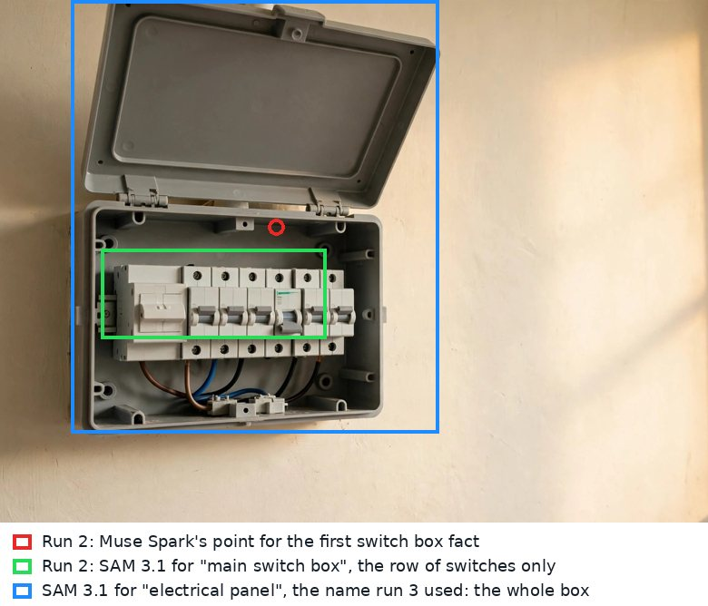

## Engineering

| Decision | Why |
|---|---|
| Models read, code decides | A model's answer is evidence, never a verdict. Every decision the family sees is made by code that can be read and tested |
| Rules in `policy.json`, pinned by SHA-256 | No model, prompt or stray edit can change a rule: the server refuses to start, and `/rules` shows the hash |
| A hash-chained, append-only log per home | Any screen can be traced to its evidence, and a changed entry is caught on every visit |
| A pure projection from events to state | The same events always give the same board; the golden test rebuilds the sample board byte for byte |
| Three-valued coverage | "Not enough was recorded" is a different problem from "nobody can do it" |
| A day-by-day simulation | Proofs last 120 days, so a job that is fine today can stop in month five |
| An exact 0/1 knapsack per day | The most important lessons fit in 20 minutes a day before the departure |
| A fenced tool loop | The model can only point at a job the search returned: no wrong job shown in 80 answers |
| It fails closed | Without SAM 3.1, object facts wait for the owner; with Meta's API failing, the help line falls back to code; a circuit breaker stops retry storms |
| Spending caps checked before every call | A daily cap and an optional lifetime cap, held by one lock per process, a file lock across processes and whole-file writes; a test spends from eight threads at once and counts every cent |
| Signed, scoped links instead of accounts | A grandmother needs no password, and a sticker can't open the house |
| A recording sent in pieces of 8 MB | A phone's 1080p video is about 130 MB a minute, and some hosts cap one request (Cloud Run at 32 MiB). After a dropped connection, the phone carries on from the last piece the server has |
| Real homes by invite code | A public copy with a key can't be used to spend it: the Start page asks for the code first, and the caps hold anyway |
| A strict Content-Security-Policy | Everything from the app's own origin: no third-party scripts, fonts or trackers |

The backend is FastAPI on Python 3.13; the web app is React 19, a PWA with an offline pack and print layouts. Both ship as one Docker image that runs as user 1000, so it deploys to a Hugging Face Space with one command.

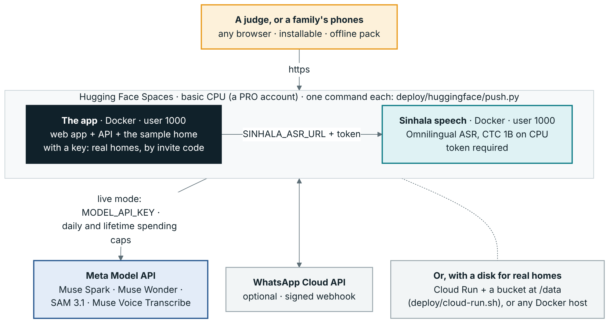

## Proof it works

| Check | Result |
|---|---|
| Backend tests (`cd backend && pytest`) | **230 passed** |
| The Sinhala service's contract tests (`services/sinhala-asr`) | **5 passed** |
| Browser checks at 375 px and 1440 px, in English and Sinhala, with the connection really cut, for accessibility, and through the guided tour step by step (`node frontend/tests/e2e.cjs`) | **118 passed** |
| The live screens, on a server in live mode whose key isn't real, so nothing is spent (`node frontend/tests/live_ui.cjs`): start a home with the invite code, refuse an oversized video before sending it, send one in pieces into the pipeline | **18 passed** |
| Golden replay: the sample board rebuilt from its log | **byte for byte** |
| **The whole web app, live on Meta's Model API** (`frontend/tests/live_full.cjs`): a six-room walk-through recorded on the Record page, then privacy, review, the board, proofs by photo and voice, the help line, WhatsApp, stickers and links, offline, deletion | **76 of 76** with the app in English, **76 of 76** in Sinhala; $0.54 and $0.45 ([the runs](docs/EVALUATION.md#the-whole-web-app-live)) |
| A walk-through through the real server's API (`scripts/live_check.py`) | **passed**: 10 facts read and verified, the spoken gate code hidden and silenced, help, tell me and show me right, 114 events with the chain intact, $0.34 |
| A Sinhala walk-through nobody could make out (`scripts/live_sinhala_unclear.py`) | **10 of 10**: every piece marked not understood, no facts read, the card still blurred |
| The model suites on Muse Spark 1.3 and Muse Spark Open, rerun on the final code | help 39 and 40 of 40, tell me 19 of 20 on both, show me 12 and 10 of 12; no wrong job shown, no false pass, no false accept |
| Held-out photo pairs, four runs (the fourth after the comparison prompt changed) | no wrong object confirmed in 116 judgments on either path |
| Sinhala speech on 189 real recordings from 12 speakers (`services/sinhala-asr/check.py`) | **12.4%** character error rate, on CPU |
| **The hosted copy** (https://nipun-dilshan-if-i-disappear.hf.space, a Hugging Face Space's basic CPU), 1 November | all **118** browser checks, the guided tour included; the API live check passed ($0.34); the whole web app live in English: **74 of 75** after the last fix (71 and 72 of 74 before it; the misses are explained); with the app in Sinhala, 73 of 74; the Sinhala walk-through nobody could make out, 10 of 10 through the Sinhala Space ([what failed and why](docs/EVALUATION.md#the-hosted-copy-1-november)) |
| The app's image, run the way a Hugging Face Space runs it (user 1000), before it was deployed | all 101 browser checks then, and in live mode all 18 live-screen checks; its ffmpeg opens phone and browser recordings and refuses playlists and concat scripts. The Sinhala image was built and run on 28 October, and gave the measured transcripts, clip for clip |

The evaluation sets were written before the runs and not changed after them, and every failure is reported as a failure ([EVALUATION.md](docs/EVALUATION.md)).

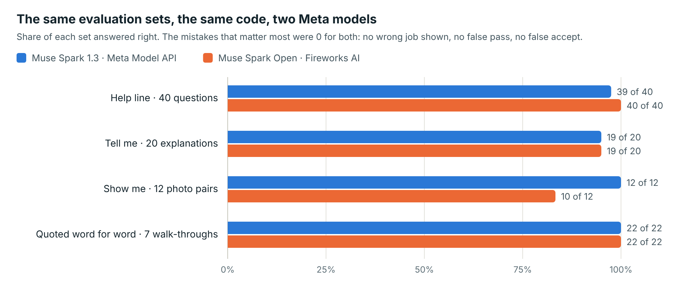

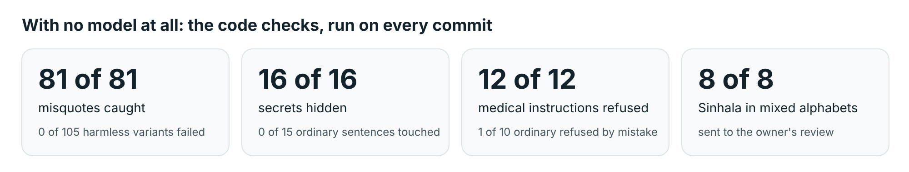

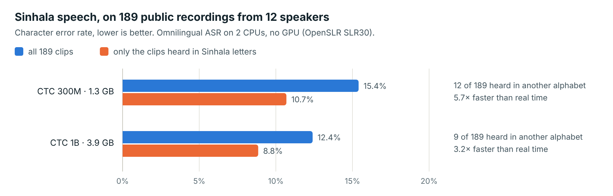

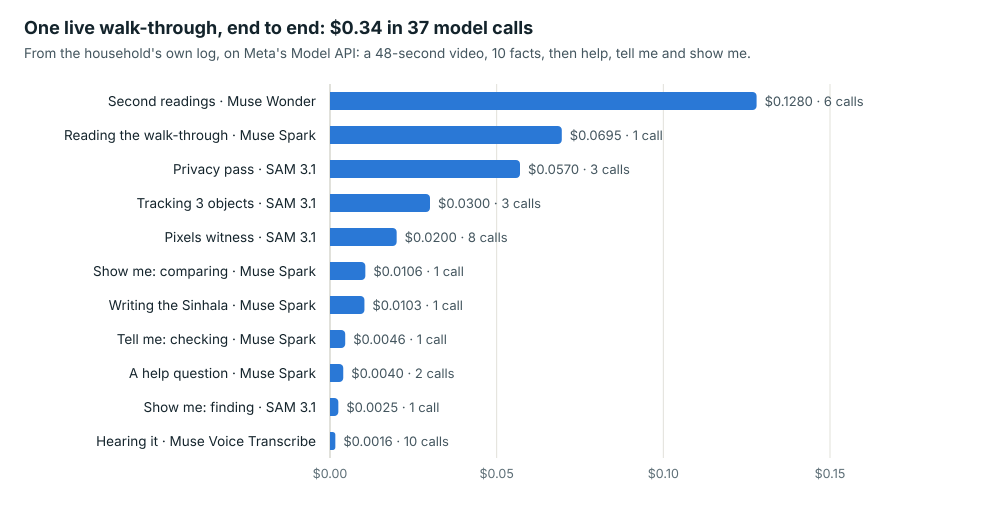

The largest cost is Muse Wonder's second readings; the reading itself costs about seven cents, and the privacy pass, which searches the whole video, about six. From these unit costs, a whole handover (four three-minute walk-throughs, every job proven by three people, a hundred help questions while away) would come to about three dollars. That is an estimate, not a measurement ([MODELS.md](docs/MODELS.md#cost)).

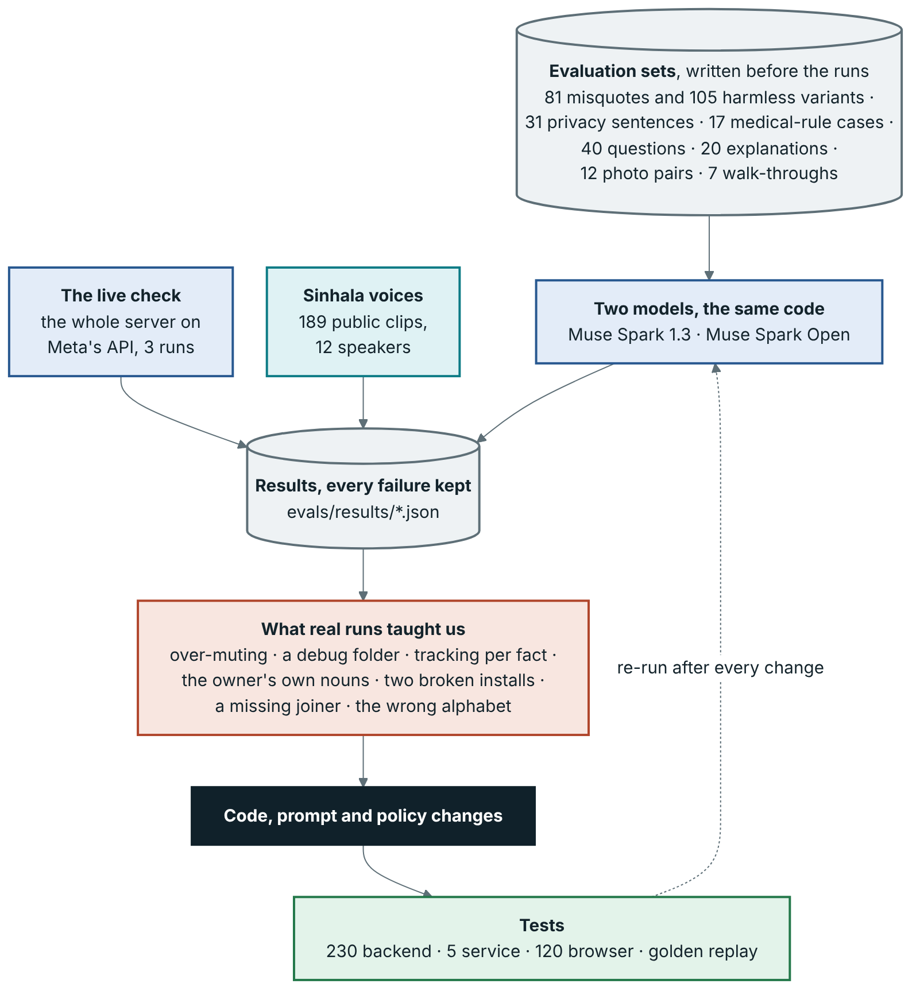

**What these numbers don't show.** The sets are small and written by the builder. The first photo pairs are crops of single photos, and the held-out ones are museum objects on plain backgrounds, both easier than a family member's photo of a cluttered room. The live runs used a synthetic voice over photos, not a real home filmed on a phone. Sinhala speech was measured on real voices, but the model may have seen that public set in training, and a whole Sinhala walk-through of a real home is still to be recorded. Real families will say things nobody wrote down here, which is why every fact waits for the owner, and every failed check says which one and why.

## Try it

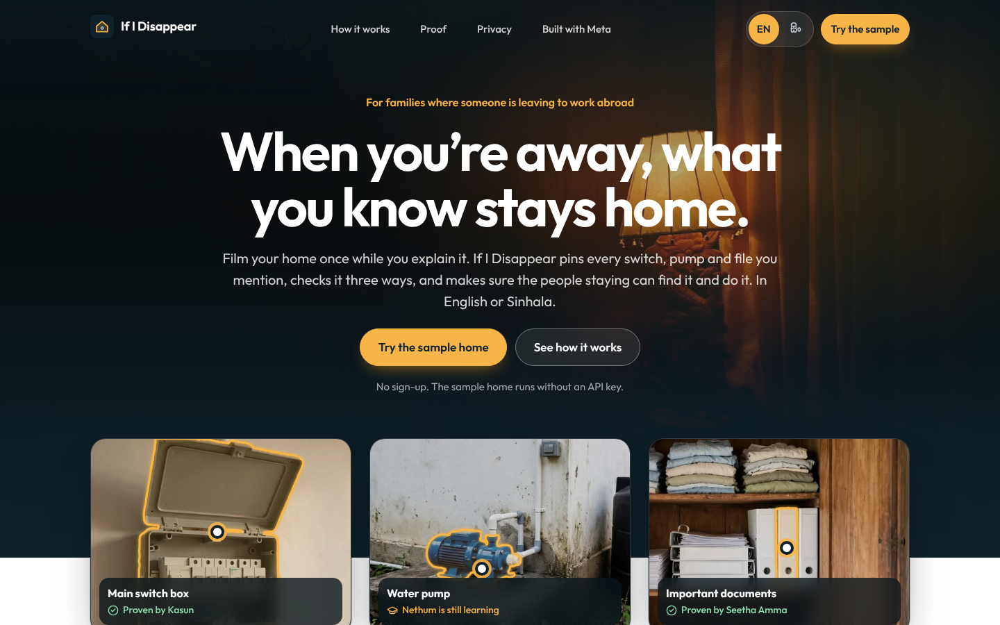

**The sample home.** Open the app at https://nipun-dilshan-if-i-disappear.hf.space and press **Try the sample home**. A guided tour opens on the first visit: 14 steps through the whole app, each one opening its page and spotlighting the part it explains, about three minutes (the compass button at the top restarts it). No sign-up and no key: you get a private copy of the Rathnayake home, deleted after a day. Dilini leaves Sri Lanka on 20 November for two years; Kasun (her husband), Seetha Amma (her mother) and Nethum (their son, 14) stay. Every model output in it is a real recorded run of Muse Spark 1.3, Muse Wonder 1.0 and SAM 3.1, and every check and decision runs live as you click. The sample's transcripts, the family's photos and answers, and Dilini's decisions are sample data, marked as such in its log ([what is real, and what is sample data](docs/JUDGES.md#what-is-real-in-the-sample-home-and-what-is-sample-data)).

Five minutes, in order ([the full tour](docs/JUDGES.md)):

1. **The board**: 4 of 6 jobs would stop; the first problem lands on 20 November, the gas cylinder.
2. **A job**: open **Main switch box**, press play, and watch SAM 3.1's outline follow the box.
3. **Prove it**: as Nethum, prove the water pump. The photo with no pump in it doesn't pass (the app asks for another), the right one passes with what matched, the first explanation misses the grinding noise, the second passes, and the board drops to 3 of 6.
4. **Help**: ask *"The pump is making a grinding noise"*, then *"I can smell gas in the kitchen"*, then try the WhatsApp preview in Sinhala.
5. **Review**: the fact where Muse Spark and SAM 3.1 disagreed about the white files, and the medicine sentence the app refused to turn into a step.
6. **Evidence**: every model output, check and decision in a hash-chained log, verified live.
7. **Card**: the fridge card and the QR stickers; open a sticker in a private window and it shows only its own job. Save the offline pack, cut the connection, and the board and every sticker still open.

**A real home.** On a copy with a Meta Model API key, **Start your own home** (`/start`) makes one: the name of the home, who is leaving, the language, the dates and, on an invite-only server, the invite code. It gives back the owner's private link; then **Record**, **People** and the rest work on real recordings.

**The demo video.** The three-minute script, written for judges watching live, is in [HACKATHON.md](docs/HACKATHON.md#demo-video-script). A 90-second captioned recording of the app, clicked through by a script, is in [`docs/demo`](docs/demo/if-i-disappear-demo.mp4).

## Privacy and safety

Secrets said out loud are hidden from the words and silenced in the sound. Cards and screens that SAM 3.1 finds are blurred. Medical instructions are never turned into steps, and the review page says which sentences were left out and why. No accounts, no trackers, no third-party scripts; links are signed and scoped, and a sticker opens one job. Model keys never leave the server, every call is priced and checked against a spending cap before it is made, and the app uses Meta's Standard mode only, never Contributor mode, because these are a family's recordings. What is kept, removed and refused, and the limits, said plainly: [PRIVACY.md](docs/PRIVACY.md).

## Run it yourself

```bash
docker build -t if-i-disappear .
docker run -p 8080:8080 -v iid-data:/data if-i-disappear     # the sample home, no key needed
# open http://localhost:8080 and press "Try the sample home"
```

With a Meta Model API key, for real recordings:

```bash
cp .env.example .env               # set MODEL_API_KEY, IID_ADMIN_TOKEN and IID_LINK_SECRET
python scripts/check_meta_api.py   # day-one checks of every call the app makes, a few cents
docker run -p 8080:8080 -v iid-data:/data --env-file .env if-i-disappear
# open http://localhost:8080/start and enter IID_ADMIN_TOKEN as the invite code
# one walk-through end to end over the API, about thirty-five cents (needs ffmpeg and espeak-ng)
IID_ADMIN_TOKEN=... python scripts/live_check.py
# the whole web app in a real browser, about fifty cents (needs Node and Playwright too)
python scripts/make_test_walkthrough.py walk en
BASE=http://localhost:8080 INVITE=<IID_ADMIN_TOKEN> VIDEO=walk/walk-en.mp4 SCRIPT=walk/walk-en.json \
  node frontend/tests/live_full.cjs
```

Without Docker:

```bash
cd frontend && npm ci && npm run build && cd ..            # builds into backend/static
cd backend && python -m venv .venv && . .venv/bin/activate
pip install -r requirements-dev.txt                        # needs ffmpeg on PATH
uvicorn app.main:app --port 8080
```

On Windows, in PowerShell, with Python 3.12 or newer, Node.js 22 and ffmpeg installed (for example `winget install Python.Python.3.13`, `winget install OpenJS.NodeJS.LTS` and `winget install Gyan.FFmpeg`, then a new PowerShell window):

```powershell
cd frontend; npm ci; npm run build; cd ..
cd backend
py -m venv .venv
.venv\Scripts\python -m pip install -r requirements.txt
.venv\Scripts\python -m uvicorn app.main:app --port 8080
```

**Deploy** on Hugging Face Spaces, one command each; Docker Spaces need a PRO account ([deploy/huggingface](deploy/huggingface/README.md)). The project's own copy runs at https://nipun-dilshan-if-i-disappear.hf.space:

```bash
export HF_TOKEN=hf_...
# the app and the sample home; with --live, your key goes to the Space as a secret,
# and it prints the invite code for /start
MODEL_API_KEY=... python deploy/huggingface/push.py app <you>/if-i-disappear --live
# Sinhala speech, joined to it
python deploy/huggingface/push.py sinhala <you>/iid-sinhala-asr --link <you>/if-i-disappear
```

Never put the key in the repository; on a Space it lives in the settings, as a secret. A Space's disk is wiped when it restarts, so a real home lasts until then; to keep real homes, use a host with a disk, or `deploy/cloud-run.sh` (secrets in Secret Manager, data on a mounted bucket). Your own domain: Hugging Face's custom domains (PRO), or a redirect from your registrar, with `IID_PUBLIC_BASE_URL` set to it. Sinhala speech elsewhere: [`services/sinhala-asr`](services/sinhala-asr/README.md) (Docker, Modal or a Space).

## Repository and documents

```
backend/        FastAPI app: pipeline, witnesses, ledger, engine, proofs, help, WhatsApp
  fixtures/     the sample home, its photos, and every recorded model run
frontend/       React 19 PWA, English and Sinhala
services/       Omnilingual ASR for Sinhala, as a small service, with its tests and measurement
evals/          evaluation sets, the runner and every result
scripts/        sample builder, day-one API checks, the live checks and their test walk-through, the diagrams and charts
deploy/         Hugging Face Spaces and Cloud Run
docs/           the documents below, the diagrams, screenshots and the recording
```

| Document | What is in it |
|---|---|
| [JUDGES.md](docs/JUDGES.md) | The five-minute tour, and what is real in the sample home |
| [ARCHITECTURE.md](docs/ARCHITECTURE.md) | The pipeline, the witnesses, the log, the engine, access |
| [MODELS.md](docs/MODELS.md) | Each Meta model, how it is called, the day-one checks, what it costs |
| [EVALUATION.md](docs/EVALUATION.md) | The evaluation sets, every number, and what real runs taught us |
| [PRIVACY.md](docs/PRIVACY.md) | What is kept, removed and refused, and the limits |
| [DESIGN.md](docs/DESIGN.md) | Who it is for, and the design system |
| [HACKATHON.md](docs/HACKATHON.md) | Submission notes, the video script, the build log |
| [diagrams/](docs/diagrams/README.md) | All 15 diagrams and the charts, with what each colour means |
| [CREDITS.md](CREDITS.md) | Photos, fonts, models, data and libraries |

## Licence

Apache 2.0, © 2026 Nipun Dilshan Senevirathne. See [LICENSE](LICENSE) and [NOTICE](NOTICE). Meta's models are used through the Meta Model API under its terms, Omnilingual ASR under Apache 2.0, the SAM parser and components under the SAM License; photos, fonts and data as listed in [CREDITS.md](CREDITS.md).
