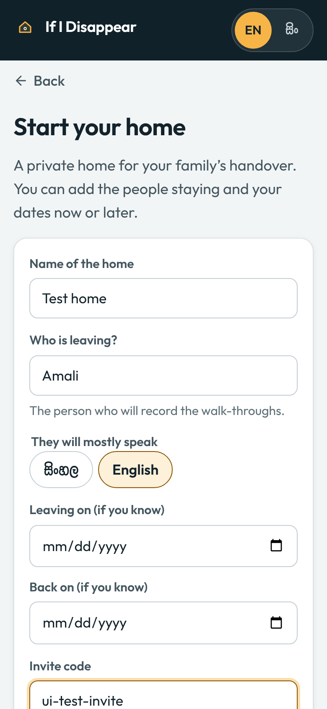

# Hosting on Hugging Face Spaces

Two Docker Spaces: the app, and Sinhala speech beside it. Both run on Hugging Face's basic CPU
(2 vCPUs, 16 GB of memory) and get a public `https://<you>-<space>.hf.space` address. Docker
Spaces need a **PRO account**: since mid-2026 Hugging Face refuses them on a free account (HTTP
402).

**The project's own copy:** https://nipun-dilshan-if-i-disappear.hf.space, deployed with these
commands on 1 November 2026 and tested there (below).

```bash
pip install huggingface_hub
export HF_TOKEN=hf_...          # huggingface.co → Settings → Access Tokens, with write access

# 1. The app. The sample home works at once, with no model key.
python deploy/huggingface/push.py app <you>/if-i-disappear

# 2. Optional: Sinhala speech, joined to the app (sets SINHALA_ASR_URL and SINHALA_ASR_TOKEN on it).
python deploy/huggingface/push.py sinhala <you>/iid-sinhala-asr --link <you>/if-i-disappear
```

`--dry-run` only assembles the folder that would be pushed, so you can look at it first.

## Fully working, with your Meta Model API key

Push the app with `--live` and your key in the environment:

```bash
MODEL_API_KEY=... python deploy/huggingface/push.py app <you>/if-i-disappear --live
```

The key goes to the Space as a **secret**: the app reads it from there, nobody can see it, and it
is never written to a file. Never put the key in the repository: anything there is public.
`--live` also:

- makes the **invite code** for the Start page (`IID_ADMIN_TOKEN`) and prints it once. Keep it.
  New real homes are invite-only, so a public Space can't run up a bill;
- makes the key that signs every link and QR sticker (`IID_LINK_SECRET`);
- sets a lifetime spending cap of $25 (`IID_TOTAL_BUDGET_USD`) beside the daily cap of $5
  (`IID_DAILY_BUDGET_USD`). Every model call is priced and checked against both before it is made.

Set any of them yourself first to choose your own. To change the key later, open the Space's
**Settings → Variables and secrets**, set the secret `MODEL_API_KEY`, and restart the Space.

Then open `https://<you>-if-i-disappear.hf.space/start`, enter the invite code, keep the private
link it gives you, and record from **Record**. Walk-throughs go up in pieces of 8 MB, so a long
phone video (up to 1 GB, `IID_MAX_UPLOAD_MB`) doesn't meet a limit on any single request.

Check it end to end from your own machine (about thirty-five cents):

```bash
BASE=https://<you>-if-i-disappear.hf.space IID_ADMIN_TOKEN=... python scripts/live_check.py
```



**For the judges.** The sample home needs nothing from them. To let them record a home of their
own, put the invite code in the submission form's private notes, not in the public README.

**Your own domain.** Hugging Face's custom domains (a CNAME record pointing to `hf.space`, then the
domain in the Space's settings) come with PRO. Or forward the domain to the Space's address with
your registrar or a Cloudflare redirect rule. With a custom domain, set the variable
`IID_PUBLIC_BASE_URL` to it, so QR stickers and WhatsApp links use it.

## What was tested on the hosted copy

On 1 November 2026, on https://nipun-dilshan-if-i-disappear.hf.space with the Sinhala Space
joined to it, from a browser and a script outside Hugging Face:

| Check | Result |
|---|---|
| The browser checks on the sample home (`node frontend/tests/e2e.cjs` with `BASE` set to the Space) | 118 of 118, the guided tour included |
| One walk-through through the API (`scripts/live_check.py`) | passed, $0.34 |
| The whole web app live, in English (`frontend/tests/live_full.cjs`) | 71 and 72 of 74; 74 of 75 after the last fix (the miss: the test machine's network dropped a download) |
| The whole web app live, with the app in Sinhala | 73 of 74 |
| A Sinhala walk-through nobody could make out, heard by the Sinhala Space | 10 of 10 |

What failed, what changed, and how long things take on two CPUs:
[EVALUATION.md](../../docs/EVALUATION.md#the-hosted-copy-1-november). These runs found five
problems the local runs couldn't, each now fixed:
- saved homes opened offline as a blank page (the Space adds `Vary: origin`);
- the next visitor's clean-up deleted other visitors' copies of the sample;
- clips were slow to cut on two CPUs;
- WhatsApp links pointed at localhost;
- Muse Spark called the walk-through's clock a different clock because the video still was darker
  than the new photo.

Sinhala speech is slower here than on the build machine: about half real time, so a
three-minute Sinhala walk-through takes about six minutes to hear.

Before that, on 28 October to 1 November, both images were built with their own Dockerfiles and run
as user 1000, the user Spaces run every container as: all the browser checks and the live-screen
checks passed against the container, and the Sinhala image loaded `omniASR_CTC_1B_v2` and gave the
same transcripts, clip for clip, as the measured run in `services/sinhala-asr/README.md`.

## Limits

- A Space on the basic CPU sleeps after about two days without visitors, and the next visit wakes
  it, which can take a few minutes (the Sinhala Space downloads its 3.9 GB model again when it
  wakes).
- The disk is wiped on every restart. That suits the sample home, which makes a fresh private copy
  for each visitor. A real home lasts until the next restart, long enough to record a demo and for
  a judging week, and the spending caps count from the last start too. To keep real homes,
  Hugging Face recommends attaching a Storage Bucket as a volume (mounted at `/data`, where the app
  keeps everything); that hasn't been tested with the app's log. Any Docker host with a disk
  keeps them too, and `deploy/cloud-run.sh` keeps them on a mounted Cloud Storage bucket.
- Two CPUs are slow for video: a clip takes ten to twenty-five seconds to cut. So the sample
  home's job clips are cut once when the Space starts and shared by every visitor's copy, and a
  real home's are cut in the background twenty seconds after the owner's last decision on Review
  (`IID_WARM_CLIPS=1` in the Dockerfile). A clip asked for before then is cut on the spot.
  Cutting the sample's ten clips takes about three and a half minutes after each start, and a
  clip a visitor changed in that time can take more than thirty seconds to appear.
