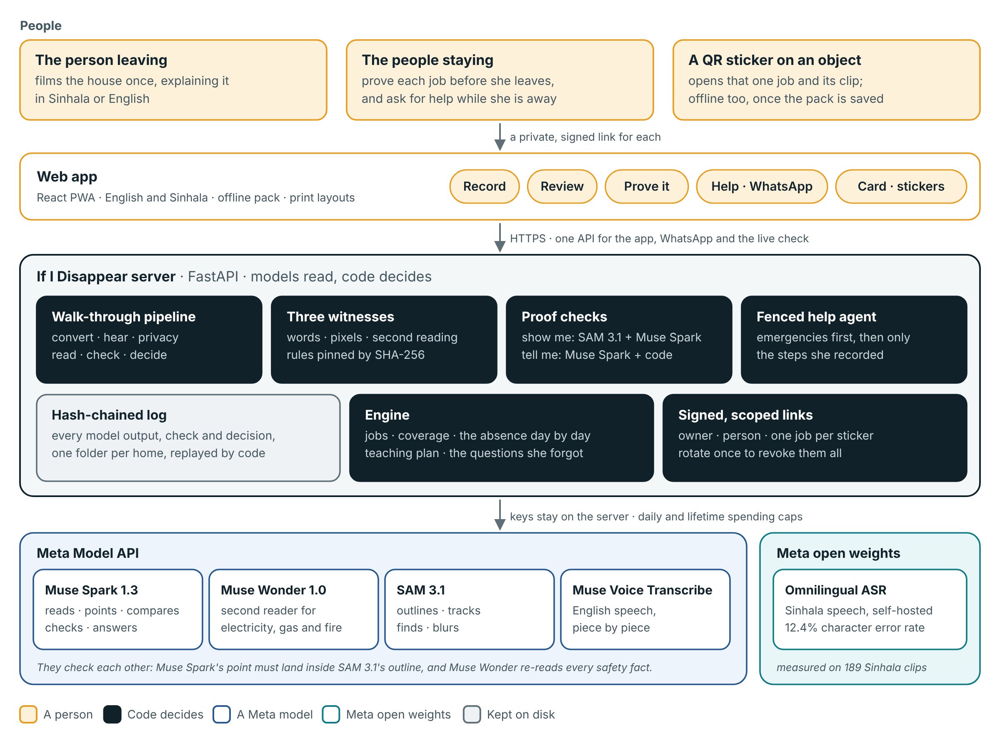

# Architecture

One rule runs through the whole app: **models read, code decides.** Meta's models turn video, speech and photos into structured claims and comparisons. Deterministic code checks every claim, applies rules a model can't change, and computes everything the family sees. Every step is written to a hash-chained log, so any screen can be traced back to the words, pixels and model outputs behind it.



Every part below has its own diagram in [diagrams/](diagrams/README.md).

## 1. From a walk-through to facts (`backend/app/pipeline/ingest.py`)

| Step | What runs | Output |
|---|---|---|
| Convert | FFmpeg | H.264 MP4 (for phones and SAM 3.1), 16 kHz mono WAV, a still every 2 seconds |
| Hear | The audio is cut at pauses first. Then Muse Voice Transcribe for English (the family's names as keywords, four pieces at a time); Omnilingual ASR for Sinhala (self-hosted, `sin_Sinh`, pieces under its 40-second limit). A Sinhala piece that comes back mostly in another alphabet is marked unclear and never read | Timed turns, about a sentence each |
| Privacy | `privacy/scrub.py` on the words; SAM 3.1 on the whole video (a two-frames-a-second copy made from the upload, up to 1280 px), then `privacy/redact.py` and FFmpeg | Secrets replaced by `[hidden]` and their turn silenced in the video; cards, ID cards and screens blurred in the video and the stills. All of this happens in a staging folder: nothing of the recording is kept until it is done |
| Read | One Muse Spark call with the turns and up to 40 stills, `response_format: json_schema` with `strict: true`; no call at all when nothing could be made out. Then a short Muse Spark call writes the Sinhala of every new fact and job name (`spark.translate_si`), used only if it is well formed (`gate.sinhala_problem`) | Typed claims: kind, job, both languages, exact quote, turn, time, object noun, point on a still, safety, schedule, contact |
| Check | Three witnesses (below), four claims at a time, in order | A status for each claim |
| Decide | The policy gate, then the owner | Accepted claims become the handover |

The schema has no nullable unions: absent values are `-1` or `""`, so constrained decoding stays simple. Model output is then cleaned by code before anything is stored: invisible characters removed (the Sinhala zero-width joiner kept), job names in sentence case, "once" schedules dropped from ordinary facts, job types corrected when the facts contradict them, and every claim of a job given one name and the highest safety level any of its claims has (`consolidate`). Each of these rules came from a real model run; see [EVALUATION.md](EVALUATION.md).

## 2. Three witnesses and a gate (`backend/app/witness/`)

A claim is shown to the family only if its witnesses agree and the owner accepts it.

- **The words** (`words.py`, code). The quote must appear word for word in the cited turn, near the cited time (2 s before to 4 s after), and be at least 6 characters long. Punctuation, case and the Sinhala zero-width joiner are normalised first. A failed check shows the closest words that were really said.
- **The pixels** (`pixels.py`, SAM 3.1 and code). For a claim about a visible object, Muse Spark gives a point on the still; SAM 3.1 is prompted with the object's noun on that still; code checks that the point falls inside a mask with confidence of at least 0.5. Two models that never see each other's answer have to agree on where the object is.
- **A second reading** (`reading.py`, Muse Wonder). For electricity, gas and fire facts, a second model reads the claim, the owner's exact words, the whole turn, and the still with SAM's box, and can only answer *uphold* or *flag*, with a reason in English and Sinhala. It never rewrites anything.

**The gate** (`gate.py`) then applies `policy.json`:

| The claim | Witnesses that must pass |
|---|---|
| Any claim | words |
| A claim that names a visible object | words, pixels |
| A claim about electricity, gas or fire | words, pixels (when it names an object), second reading |

`policy.json` lists the witnesses by the job's safety (none, water, electricity, gas, fire); code then adds the pixels for any claim that names an object and drops them for one that doesn't. Medical instructions are refused in both languages, whatever the witnesses say. A Sinhala translation that slips in letters from another script (seen in a real run: a Kannada letter) goes to review. The SHA-256 of `policy.json` is pinned in `gate.py`; if the file changes without the pin, the server refuses to start, and `/rules` shows both values.

## 3. The ledger (`backend/app/ledger/`)

Each household is one append-only JSON Lines file. Every event (`household.created`, `recording.transcribed`, `claims.proposed`, `witness.recorded`, `claim.gated`, `claim.decided`, `proof.recorded`, `help.answered`, `cost.recorded` and the rest) carries its actor and the SHA-256 of the event before it. Appends take a file lock and are `fsync`ed. Nothing is edited in place: the household is recomputed from the log by a pure function (`projection.py`), so the same events always give the same board. The Evidence page re-verifies the chain on every visit.

Actors say who did what: `model:muse-spark-1.3`, `model:sam-3.1`, `code`, `owner`, `person:<id>`, and in the sample home `recorded:<model>` (a real recorded model output, replayed) and `sample:<model>` (sample data: the written transcripts).

## 4. The engine (`backend/app/engine/`)

All deterministic and covered by tests, including a golden test that rebuilds the sample board byte for byte.

- **Jobs** (`tasks.py`): accepted claims grouped by job, with steps, warnings, contacts, the object and its clip, and the points a person must explain.
- **Coverage** (`coverage.py`): for each job, three values plus one. *Covered* (someone staying has proven it), *at risk* (someone tried and hasn't passed yet, or what they proved has since changed), *uncovered* (nobody has tried), and *unknown* (not enough was recorded to prove it). A safety job needs both proofs from the same person; other jobs need one. Proofs last 120 days; the latest attempt wins.
- **A proof is for the job as it was** (`tasks.py`): each proof stores a fingerprint of what it proved. *Tell me* proves the instructions (every required point, its kind, whether it is a safety point, in the language explained); *show me* proves the object (which recording, still and outline). When the owner rewords a step, rejects one or records the object again, earlier proofs of that part stop counting, and the board asks the person to prove it again. Changes of case, spacing, punctuation and invisible characters don't count as changes.
- **The headline**: how many jobs would stop if the person left tomorrow.
- **Simulation** (`simulate.py`): every day of the absence, to the day the person is back (up to five years), which jobs fall due, and whether a proven person will still be proven that day. A proof can run out during a two-year absence, so a job that is fine today can be at risk in month five; the board shows the first day something stops, and says how far it looked.
- **Teaching plan** (`plan.py`): what to teach to whom on each day before departure, within a set number of minutes a day. Each day is an exact 0/1 knapsack (dynamic programming), with safety and frequency as value.
- **Gaps** (`gaps.py`): code knows what each kind of job needs (an appliance needs where, how, what if it fails, and who to call). Whatever wasn't said becomes a plain question for the owner.
- **Not used** (`board.left_out`): any sentence no fact came from is listed for the owner, and code says why when it can (medical instructions are never turned into steps).

## 5. Proving a job (`backend/app/proof/checks.py`, `service.py`)

- **Show me**: the family member photographs the object. First, code refuses a photo that is a picture from the app itself: its fingerprint (a difference hash) is compared with every still of the job and crops of them (`media/likeness.py`). Then SAM 3.1 must find the object (confidence ≥ 0.5). Muse Spark compares a crop of their photo with a crop of the owner's still and lists matching and mismatching features. Code gives one of three answers: *verified* only if Muse Spark says it is the same object *and* at least two concrete features match; *a different one* when it says not, naming what differs; and *can't tell* (nothing found, too unsure, nothing that tells this one apart), which asks for another photo and is never turned into a pass.
- **Tell me**: the family member explains the job out loud, in either language. A typed explanation that is the written steps pasted back is refused. Muse Spark marks each required point as covered or not and copies the words that cover it. Code then checks each copied quote really is in what they said, and passes the explanation only if at least 75% of the points and every safety point are covered.

## 6. Help while away (`backend/app/help/`)

The help agent can't give advice of its own. Code first checks for emergencies (a gas smell, fire, smoke, a shock, in English and Sinhala) and answers those with Sri Lanka's emergency numbers before any model runs. A question about medicine is answered by code too: nothing about medicine is recorded, so it says so and gives the ambulance number. Otherwise Muse Spark runs a short tool loop with three tools: `search_steps` (code retrieval over the recorded jobs), `answer_with_task` and `not_recorded`. The fence: code checks that the job it picked was really returned by a search in this conversation, and the answer shown is always the owner's recorded steps, never model text. The same answer goes to the web page, to a voice question, and to the WhatsApp help line (Cloud API, every webhook checked against `X-Hub-Signature-256`). A spoken question nobody could make out (every piece in letters that aren't the language's, or nothing said) is not answered as an empty one: the page asks for it again, a WhatsApp voice note gets a reply asking for it again or typed, nothing is kept and no model is asked a blank question.

Without a live model, code picks the best match if it clears the policy's threshold, and the answer says "chosen by code".

## 7. Access without accounts (`backend/app/security.py`)

There are no passwords. Three kinds of signed link (itsdangerous, with an expiry for each kind):

- **Owner**: full control of one household, kept on the owner's phone.
- **Person**: one person staying can read the handover, prove jobs and ask for help, but can't see the review queue or the transcripts, or edit anything.
- **Sticker**: printed as a QR code next to an object. It opens that one job and its clip, nothing else.

What each may open, media included, is decided in one place (`scope.py`; the table is in [PRIVACY.md](PRIVACY.md#who-sees-what)). A family member never gets the whole walk-through: each job has its own clip, cut by code from the video after the privacy pass to the stretch where its facts were said, with any speech no accepted fact came from silenced. Its file name says what it covers, so when the owner's decisions change, a new clip is cut. Every token carries the household's link version; rotating links revokes all of them at once, and removing a person revokes theirs. Media paths are checked to stay inside the household's folder. Requests are rate-limited per client. Responses carry a strict Content-Security-Policy (everything from the app's own origin, no third-party scripts, fonts or trackers), `X-Frame-Options: DENY` (or, with `IID_FRAME_ANCESTORS` set, framing by that one site only, as a Hugging Face Space needs) and `nosniff`. Model keys exist only on the server.

## 8. Offline and print (`frontend/public/sw.js`, `pages/Card.tsx`)

A service worker keeps the app shell. **Save for offline** stores the board, the job pages and their clips on the phone; video is answered in byte ranges so it plays with no connection, and every saved copy is looked up ignoring `Vary` (a Hugging Face Space adds `Vary: origin` to every response, which otherwise kept the saved script from matching). A sticker scanned on that phone with no connection opens its job and clip from the same saved copy: the link says which home and which job, and the phone shows only what it had already saved (the signature can only be checked by the server, so offline the link is used for nothing else). The fridge card and stickers are print-ready pages with QR codes generated on the device. The browser checks test all of this with the connection really cut, through a relay the test switches off.

## 9. Two modes

- **Judge mode** (no key): `/try` copies the sample home into a private household that is deleted 24 hours after its last change. Every copy shares the sample's job clips, cut once when the server starts (`IID_WARM_CLIPS=1`), since cutting video on a small host's CPUs takes 10 to 25 seconds a clip. Its model outputs are real recorded runs of Muse Spark 1.3, Muse Wonder and SAM 3.1, replayed; every check and decision runs live.
- **Live mode** (`MODEL_API_KEY` set): real recordings, real model calls, with a daily spending cap (`IID_DAILY_BUDGET_USD`) and an optional lifetime cap. Before every call the client reserves the most it could cost (output is bounded by `max_completion_tokens`, so the most is known), under a process lock and a file lock, and settles the real cost after; two requests can't both spend the last dollar, and a call that times out is counted as spent. One circuit breaker per provider is shared by every request, so a provider that is down is left alone for a while instead of retried by each request. An answer the model cut off at the length limit is an error, never half a result. A real household starts at `/start`, which asks for the invite code (`IID_ADMIN_TOKEN`) unless `IID_ALLOW_PUBLIC_LIVE` is on, and gives back the owner's private link. A recording goes up in pieces (`IID_UPLOAD_CHUNK_KB`, 8 MB), each its own request, up to `IID_MAX_UPLOAD_MB` (1 GB) in all: a phone's 1080p video is about 130 MB a minute, some hosts cap one request (Cloud Run at 32 MiB), and after a dropped connection the phone carries on from the last piece the server has. A piece that breaks off is cut back, so nothing half-written stays; an unfinished upload is deleted after a day. Work that waits on a model (checking a photo or an explanation, a spoken question, a spoken answer, a WhatsApp reply) runs on a worker thread, never on the server's event loop, so one person's photo check doesn't stop the server answering everyone else; a test checks it on a real server.

## Where things are

```
backend/app/
  main.py            HTTP API, security headers, rate limits, static app
  service.py         one household: state, proofs, help, answers
  config.py          settings from the environment (no secret has a default)
  domain.py          the data types
  pipeline/          walk-through ingest, speech, clip tracking, typed answers
  meta/              model client (retries, breaker, budget), prompts, schemas, SAM parsing, prices
  witness/           words, pixels, second reading, the gate and policy.json
  engine/            jobs, coverage, simulation, plan, gaps, the board
  proof/             show-me and tell-me decisions
  help/              retrieval, emergencies, the fenced agent
  privacy/           secret scrubbing, card blurring
  ledger/            the hash-chained log and its projection
  whatsapp/          Cloud API webhook and replies
frontend/src/        React 19 app: pages, components, i18n (en, si), lib
services/sinhala-asr Omnilingual ASR as a small HTTP service (Docker, Modal or a Space), its tests and its measurement
evals/               evaluation sets and the runner
scripts/             sample builder, day-one API checks, image tools
```
