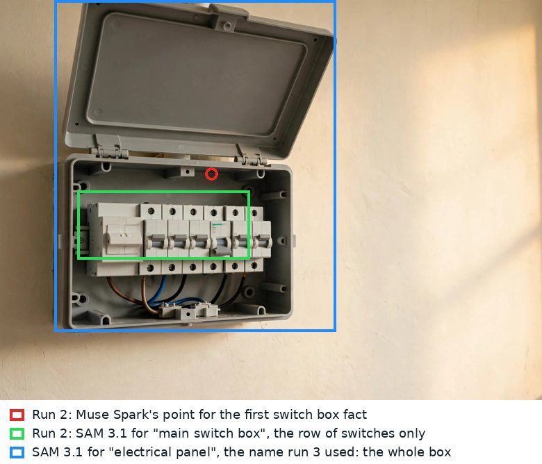

# Evaluation

What was measured, how, and what the real model runs taught us. Every number here comes from `evals/run_evals.py`, whose raw results are in `evals/results/`. The evaluation sets were written before the runs and were not changed after them: failures are reported as failures.

## How to run it

```bash
python evals/run_evals.py                 # the code checks: no model, no cost
python evals/run_evals.py --model         # also the model suites, with the configured model
```

The model comes from the app's settings: `MODEL_API_KEY` for Meta's Model API (Muse Spark 1.3), or `MODEL_PROVIDER=fireworks` for Muse Spark Open. Spending stops at `IID_DAILY_BUDGET_USD` and `IID_TOTAL_BUDGET_USD`.

## The sets

| Set | File | What it holds |
|---|---|---|
| Misquotes | generated from the sample home's facts | For each real quote: a dropped word, an added word, two words swapped, the meaning reversed; plus harmless variants (punctuation, case, spacing, quote marks) that must still pass |
| Secrets | `evals/data/privacy.jsonl` | 31 sentences in English and Sinhala: 16 with a PIN, password, OTP, card, NIC or account number, 15 ordinary sentences that look a bit like them |
| Medical | `evals/data/medical.jsonl` | 22 sentences in English and Sinhala: 12 medical instructions, 10 ordinary ones that share words ("the dose of fertiliser", "the tablet charger", "the pillow covers", "two slices of bread", "the water pressure"). Five were added on 29 October with the new medicine words, after the held-out help line found a gap ([below](#held-out-sets-frozen-before-they-were-run)) |
| Mixed script | `evals/data/script.jsonl` | 8 Sinhala translations, some with letters from another script slipped in |
| Help questions | `evals/data/help_questions.jsonl` | 40 questions (25 English, 15 Sinhala): 27 about recorded jobs, 8 about things never recorded, 5 emergencies (gas, smoke, a shock, fire) |
| Explanations | `evals/data/tell_answers.jsonl` | 20 spoken explanations of the sample home's jobs (12 that should pass, 8 that should not): full, partial, wrong, "I don't know", in both languages and in Singlish |
| Photo pairs | `evals/data/show_pairs.json` | 12 pairs: the same object from another angle or closer, a different object of the same kind, a different object altogether |
| Walk-throughs | `evals/data/walkthroughs.json` | 7 new transcripts with gas, water, keys, a bank card, medicine, code-mixed Sinhala and a spoken PIN, read by the model and checked by the real witnesses and rules |

## Results

### The model suites

Both models ran the same suites through the same code: the same prompts, fences, witnesses and rules. They ran first on 28 October, and again on 1 November on the final code, after the changes to the help line, the photo check and the Sinhala described below. Muse Spark 1.3 on Meta's Model API ([`muse-spark-1.3.json`](../evals/results/muse-spark-1.3.json)); Muse Spark Open, Meta's open weights, on Fireworks AI ([`muse-spark-open.json`](../evals/results/muse-spark-open.json)). The table is the final run; the 28 October runs are kept beside it ([Muse Spark 1.3](../evals/results/muse-spark-1.3-2026-10-28.json), [Muse Spark Open](../evals/results/muse-spark-open-2026-10-28.json)), and where a number moved, the 28 October one is in brackets.

| Suite | Muse Spark 1.3 | Muse Spark Open |
|---|---|---|
| Help line, with the fence (40 questions) | **39 of 40** right; wrong job shown: 0 | **40 of 40** right (39); wrong job shown: 0 |
| Tell me (20 spoken explanations) | **19 of 20** right; false passes: 0 | **19 of 20** right; false passes: 0 |
| Show me (12 photo pairs) | **12 of 12** right; false accepts: 0 | **10 of 12** right (11); false accepts: 0 |
| Reading walk-throughs (7 new transcripts) | 22 facts; **22 of 22** quotes found word for word | 22 facts (23); **22 of 22** quotes found word for word |
| Medical instructions turned into facts | 0 | 0 |
| Secret values inside a fact | 0 | 0 |
| Job types code had to correct | 0 | 0 |
| Time for the 40 help questions | 88 s (105 s) | 205 s (334 s) |
| Cost of the whole run | $0.52 | $0.45 ($0.47) |

Every mistake in the final run:

- **Help line, Muse Spark 1.3.** "Does Nethum have class on Wednesday?" got "not recorded" instead of the pickup job, in both runs (Muse Spark Open made the same mistake on 28 October, not on 1 November). That is the safe way to be wrong: the person is told it wasn't recorded rather than shown the wrong steps, and in all 160 answers across both runs the fence never let either model show the wrong job.
- **Tell me, both models, the same answer, in both runs.** The set marks this Sinhala explanation as a pass: *"බදාදාට හවස පහට බස් නැවතුම්පොළට ගිහින් නෙතුම්ව එක්කගෙන එනවා"* ("on Wednesdays at five I go to the bus stop and bring Nethum home"). Both models said it misses the point "Nethum has extra class every Wednesday until 5 PM", because it never mentions the class. That is the rule in the findings below (a point is covered only when its whole content is said), so the models were consistent with the app and the set's label was arguably too generous. The label is kept, and it counts as a failure.
- **Show me, Muse Spark Open only.** A second photo of the same plain white files: it would not confirm them, because nothing on plain files is unique and the second photo looked like a copy of the first (both runs). On 1 November it also refused a closer photo of the same switch box: "generic type match only". Muse Spark 1.3 confirmed both, naming the features that matched. They are refusals, not false accepts, and those jobs can still be proven by explaining them.
- **Reading, both models.** Every quote was found word for word. In the reading call's own Sinhala, Muse Spark 1.3 slipped a letter from another script into one fact, and the rule caught it; in the app, the Sinhala now comes from a short call of its own after reading ([below](#the-whole-web-app-live)).

After the reading prompt's rule for object names changed (see [the live check findings](#the-live-check)), the reading suite ran again on both models: 22 of 22 quotes word for word on each, no medical fact, no secret value, no job type corrected ([`muse-spark-1.3-reading-rule7.json`](../evals/results/muse-spark-1.3-reading-rule7.json), [`muse-spark-open-reading-rule7.json`](../evals/results/muse-spark-open-reading-rule7.json)).

The two models read the walk-throughs differently but acceptably: Muse Spark 1.3 called the gas job "gas cylinder" (a supply), Muse Spark Open "gas regulator" (an appliance), from the same words. Neither turned a medicine sentence into a fact, and neither put a spoken PIN or card number into one.

### Held-out sets, frozen before they were run

The sets above were written while the app was built, so its prompts and rules were tuned on them. On 29 October four new sets were written, labelled and frozen before their first run ([`evals/heldout`](../evals/heldout/README.md): the SHA-256 of every file is in `MANIFEST.json`, and `evals/run_heldout.py` refuses to run if one has changed). Each suite also ran without the part of the app it tests, so what each part adds can be seen, with every denominator and every error. One run, on Meta's Model API (Muse Spark 1.3, Muse Wonder 1.0, SAM 3.1), $1.52: [`heldout-muse-spark-1.3.json`](../evals/results/heldout-muse-spark-1.3.json).

**Show me: Muse Spark alone, against SAM 3.1 then Muse Spark (the app).** 29 pairs of independent photographs, two photographs the Metropolitan Museum of Art took of one object or of two objects of the same kind (public domain, CC0).

| Pairs | Muse Spark alone, whole photos | SAM 3.1 then Muse Spark (the app) |
|---|---|---|
| The same object, 12 | 11 confirmed, 1 called different | 9 confirmed, 2 called different, 1 asked for another photo |
| A different object of the same kind, 10 | 10 called different | 7 called different, 3 asked for another photo |
| Hard to tell, 7: old black-and-white photos, an odd angle, small in a group, blurred and dark, nothing of it to see | 3 right, 4 called different that were the same | 4 right, 3 called different that were the same |
| **A different object confirmed** | **0** | **0** |
| Told "a different one" when it was the same | 5 | 5 |
| Asked for another photo | 0 | 6 |
| Median time, cost of the 29 | 9.6 s, $0.29 | 9.7 s, $0.30 |

Neither ever confirmed the wrong object. On these photos SAM 3.1 does not make the comparison more accurate; it makes it more cautious. Where the app did worse: SAM 3.1 found no padlock in a photo of the padlock turned on its side, and in another its outline held the padlock's body but not the key drawn out of it, so the crop Muse Spark compared had no key, and it said the key was missing. Where it did better: when it couldn't see the object at all (a close-up of the maker's marks, a padlock from above), it asked for another photo instead of saying "a different one". Museum photos have plain backgrounds, the easy case for comparing whole photos; SAM 3.1's crop exists for the owner's still, where the object is a small part of a room, and nothing here tests that. So the rule stays (the object must be found, then matched), and the advice when it isn't found now names the angle: *"Take it again from the front, closer, with more light."*

**How steady are those verdicts?** The same 29 pairs ran twice more on 31 October ([`repeat 2`](../evals/results/heldout-photos-repeat-2.json), [`repeat 3`](../evals/results/heldout-photos-repeat-3.json); [`heldout-photos-consistency.json`](../evals/results/heldout-photos-consistency.json) compares the three runs). The repeats are no longer held out: they only measure how much the answers move. In 87 judgments on each side, a different object was never confirmed. The app gave the same answer in all three runs for 25 of the 29 pairs, Muse Spark alone for 22. Of the 12 same-object pairs, the app confirmed 9, 7 and 8, and Muse Spark alone 11, 9 and 11. The app confirmed six pairs every time (four kettles, a teapot and the clock under a glass dome) and three never (the padlock on its side, the padlock with its key drawn out, the cabbage-leaf teapot); three moved between runs (two of three each). One label looks doubtful on a second look: the padlock photo filed as "another photograph from the front" (468867-4) seems to show its other face, with the rivet on the other side of the shackle, which is the difference Muse Spark named when a live run called it "the same kind, but not the same physical piece". The label is kept as frozen. The live web-app run below uses the clock pair for its "same object" photo.

**A fourth run, after the comparison prompt changed (1 November).** On the hosted copy, Muse Spark twice called the clock a different clock when Photo A was the walk-through's still instead of the museum's photograph ([below](#the-hosted-copy-1-november)). The prompt now tells it that Photo A is a still from the owner's phone video, often softer and in other light, and that a different shade, or texture that shows more in one photo, is not a mismatch on its own; a part, label, mark or shape is. The 29 pairs ran once more with it ([`heldout-photos-prompt-2.json`](../evals/results/heldout-photos-prompt-2.json)). They are no longer held out, so this run only checks that the change does no harm. On the app's path, the 10 different objects got the same answers as in all three earlier runs (7 called different, 3 asked for another photo), and none was confirmed. 9 of the 12 same-object pairs were confirmed (9, 7 and 8 before), the cabbage-leaf teapot for the first time. A dim, blurred kettle and a teapot small in a group, called "a different one" in every earlier run, now got "couldn't tell, take another photo". A same object was called a different one 3 times, against 5, 6 and 6. Muse Spark alone, which the app doesn't use, confirmed 9 of the 12 (11, 9 and 11 before) and no different object.

**Reading walk-throughs: Muse Spark alone, then with each check added.** 8 new transcripts (5 English, 2 Sinhala, 1 Sinhala in Latin letters): a correction mid-sentence, negations in both languages, a spoken code, a medicine sentence, a date the speaker wasn't sure of. The stills aren't part of a transcript, so the pixels witness counts as passed here.

| | Muse Spark alone | + the words witness | The app: + the rules, Muse Wonder re-reads safety facts | + every fact read twice |
|---|---|---|---|---|
| Facts verified, of 22 | 22 | 19 | 17 | 16 |
| Right facts sent to the owner's review instead | 0 | 3 | 5 | 6 |
| Quotes not in what was said, verified anyway | 3 | 0 | 0 | 0 |
| Wrong facts verified | 0 | 0 | 0 | 0 |

All 17 facts the set expected were found. Every one of the 22 facts was also read by a person: all 22 are right. The set's patterns marked one as wrong, "The blue switch is for the water heater", because the pattern for *push the blue switch* took "switch" as a verb; by hand it is right, and it is counted as right above. No negation, correction, code or medicine sentence was misread, so Muse Wonder had nothing wrong to stop: of the 9 safety facts the app has it re-read, it disagreed with 2 right ones ("the owner didn't say *every* evening") and sent them to review. Re-reading all 22 facts cost $0.42, more than twice the reading itself ($0.18), which is why the app re-reads only safety facts. The words witness earned its place: the model had rewritten 3 of the 22 quotes, all Sinhala, changing letters (*කරලා* came back as *කරසා*), and all 3 went to the owner instead of being trusted.

**Tell me: Muse Spark's judgment alone, then with the quote and required-point checks.** 20 explanations (9 Sinhala, 11 English or Sinhala in Latin letters), 8 that should pass. Both: **20 of 20**, no false passes, no false fails. The checks changed nothing here; they are there for the answer a model passes without the words to back it, and this set had none.

**Help line: keywords alone, against Muse Spark inside the fence (the app).** 32 questions: 18 about recorded jobs, 8 about things never recorded, 4 emergencies, 2 about medicine.

| | Keywords, no model | Muse Spark inside the fence |
|---|---|---|
| Recorded jobs found, of 18 | 9 | **17** |
| Never recorded, said so, of 8 | 7 | **8** |
| Emergencies, of 4 | 4 (code) | 4 (code) |
| Medicine refused by code, of 2 | 1 | 1 |
| **A wrong job shown** | **1** (*"When does the water bill come?"*: the water pump) | **0** |

Muse Spark's one miss, *"The taps are dry upstairs"*, got "not recorded" rather than a wrong job. The medicine miss was in the rule, not the model: *"Which tablets does Seetha Amma take after dinner?"* used a word the rule didn't have, and Muse Spark then ran out of steps and said "not recorded". No medicine instruction was given, but code didn't step in with who can help. Changed after the run: the policy now also refuses *tablets*, *capsules*, *painkillers*, eye and ear drops and cough syrup, and the Sinhala ways of saying a pill is taken (*පෙති* or *පෙත්ත* with *බොන*, *ප්‍රෙෂර් පෙත්ත*, *සීනි පෙත්ත*). *Tablet* on its own stays allowed (a tablet computer), and so does *පෙති* on its own, which also means slices and a motor's fins; tests hold both. That question is therefore no longer held out.

### One live walk-through, end to end

[`scripts/live_check.py`](../scripts/live_check.py) sends one walk-through through a running server on Meta's Model API, over the same HTTP API the web app uses. It creates a household, uploads the video, follows the pipeline, accepts what was verified, asks the help line two questions, checks one explanation and one photo, adds up the cost from the household's own log, and deletes the household. Without a video of your own it makes one: three of the sample home's photos with a synthetic English voice (eSpeak NG) saying ten sentences, one of them a gate code. It ran three times on 28 October; the first two runs each changed the code (see [the live check findings](#the-live-check)). It ran again on 1 November on the final code ([`live_check.json`](../evals/results/live_check.json)); the earlier runs are kept beside it ([`live_check-1.json`](../evals/results/live_check-1.json), [`-2`](../evals/results/live_check-2.json), [`-3`](../evals/results/live_check-3.json)).

| | 28 October, third run | 1 November, final code |
|---|---|---|
| The pipeline, for a 48-second video | 139 seconds | **85 seconds** |
| Heard | 10 pieces, one per sentence, each with its own time | the same |
| The gate code | hidden from the words (*"The gate code is [hidden]."*), its 3.5 seconds silenced in the video, and in no fact | the same |
| The privacy pass | SAM 3.1 on 12 stills, three names on each: 36 calls, $0.090 | SAM 3.1 on the whole video, three searches: 3 calls, $0.057 |
| Facts | 10 read, every quote found word for word. 9 verified; 1 sent to review because its Sinhala had letters from another script (the rule catching one live) | 10 read, every quote found word for word. **10 verified**: the Sinhala now comes from a short call of its own |
| Accepted, then tracked | the 9 verified facts; SAM 3.1 tracked the switch box, the pump and the gas cylinder through the clip (33 to 38 of 40 frames with a mask) | the 10 verified facts; the same three tracked (35 to 38 of 40 frames) |
| Help line | *"The power went off. What do I do?"*: the main switch steps. *"I can smell gas in the kitchen"*: an emergency, decided by code before any model ran | the same |
| Tell me, the pump | passed: 3 of 3 steps explained | the same |
| Show me, the pump | passed, with what matched named: *"Blue finned motor on left with rounded rear cover, Blue pump volute on right with bolted flange, Rectangular terminal box on top of motor"* | passed: *"bright blue horizontal pump with left motor and right volute in same orientation, finned motor body with rear fan cowl and top terminal box in same position, white PVC vertical discharge pipe entering top with grey coupler above"* |
| The log | 146 events, hash chain intact | 114 events, hash chain intact |
| Model calls, cost | 70 calls, $0.36 | **37 calls, $0.34** ([MODELS.md](MODELS.md#cost) has the breakdown) |

### The whole web app, live

[`frontend/tests/live_full.cjs`](../frontend/tests/live_full.cjs) does what a family does, in a real browser, on a server in live mode on Meta's Model API: every step goes through the web app's own pages, nothing is called directly. Its walk-through comes from [`scripts/make_test_walkthrough.py`](../scripts/make_test_walkthrough.py): six rooms in 71 seconds, fifteen sentences in eSpeak NG's English voice. The main switch box, the water pump, the papers in the bedroom cupboard (the camera pans onto a made-up bank card on the shelf), the padlock on the back gate, the clock in the hall, and a room where a gate code and a medicine sentence are said. The padlock and the clock are the Met's photographs, so the Met's other photographs of them can stand in for the family's own. It ran on 1 November with the app in English, and with the app in Sinhala (the owner speaking English, the family reading Sinhala): **76 of 76 checks passed in each** ([`live_full-en.json`](../evals/results/live_full-en.json), [`live_full-si.json`](../evals/results/live_full-si.json)).

| | The app in English | The app in Sinhala |
|---|---|---|
| Record: sent in pieces, the six steps ticked off as each finished | 158 s: convert 12, hear 8, privacy 49, read (with the Sinhala) 58, check 31 | 139 s |
| The card on the shelf | found by SAM 3.1 in 20 frames (34.5 to 44 s); in the kept video its digits are blurred to 0.001 of their sharpness, and the rest of the shelf keeps 0.84 of its own | the same |
| The gate code, the medicine | the code hidden from every text the app keeps and its 3.5 s silenced; the medicine sentence refused by code and listed under **Not used** | the same |
| Facts | 18 read; 15 verified, 3 sent to review: SAM 3.1 found no pump in the pump room's first, wider frame, and twice Muse Spark pointed beside the white files SAM 3.1 outlined | 15 read; 14 verified, 1 sent to review (the same wide frame of the pump) |
| Review | one fact reworded (marked as the owner's own words, the other language as not yet translated), one rejected, the rest accepted | the same, in Sinhala |
| The board | 5 jobs, each titled in both languages; SAM 3.1 tracked all 5 objects through their clips (34 to 40 of 40 frames) | the same |
| A job's clip | the rejected fact's words are silent in it, the accepted ones heard; when the rejection is undone, the clip is cut again with those words | the same |
| Show me | the app's own still, saved again: refused as not a new photo. A different padlock: not passed (*"not the same physical padlock"*). The padlock from the side and above: *"couldn't tell"*, another photo asked for. **The clock from the front in other light: passed**, with what matched named | the same |
| Tell me | the whole explanation: passed. The safety step left out: not passed. The written steps pasted back: refused. Spoken: passed, 3 of 3 steps | typed in Sinhala: the same. Spoken in eSpeak's Sinhala voice, which Omnilingual ASR writes in other alphabets: asked to say it again, not judged |
| Help line | 6 of 6: the two recorded jobs found, the washing machine "not recorded", a medicine question and a gas smell answered by code, a PIN in a question hidden before it was kept or shown back | 6 of 6, asked in Sinhala |
| Help by voice | *"The water tank is empty. What should I do?"*: the water pump | a real Sinhala recording (OpenSLR SLR30, about village news): heard in Sinhala letters, 8.8% character error rate, and answered as not recorded |
| A spoken answer to one of the board's questions | heard, read into facts for that job, checked, waiting for review | asked to say it again (eSpeak's Sinhala) |
| WhatsApp preview | a power cut asked in Sinhala: the main switch steps, in Sinhala. The back gate key: that job | the same |
| Links | a sticker, on a phone that never opened the home, plays only its own job's clip with SAM 3.1's outline; a person's link can't open the log, the whole video or its transcript; removing a person, and replacing all links, stop the old ones at once | the same |
| Offline | the whole home saved (26 of 26 files); the board and a sticker open with the server out of reach | 27 of 27 |
| The end | 224 events, the hash chain intact; the home deleted on the People page, nothing of it left in the server's data folder | 189 events; the same |
| Cost | $0.54 | $0.45 |

On the same server, [`scripts/live_sinhala_unclear.py`](../scripts/live_sinhala_unclear.py) sent the same six rooms in eSpeak NG's Sinhala voice ([`live_sinhala_unclear.json`](../evals/results/live_sinhala_unclear.json)). Omnilingual ASR wrote all 15 pieces in Latin and Thai letters; every piece was marked as not understood and listed for the owner, no reading call was made (so nothing could come from the pictures alone), and the privacy pass still found and blurred the card: 10 of 10 checks.

### Sinhala speech, on real Sinhala voices

Muse Voice Transcribe has no Sinhala, so Sinhala walk-throughs go to Meta's open-source Omnilingual ASR, run as a small service ([`services/sinhala-asr`](../services/sinhala-asr/README.md)). It was measured on 28 October on public Sinhala recordings: [OpenSLR SLR30](https://www.openslr.org/30/), collected by Google in Sri Lanka (CC BY-SA 4.0), 189 clips from 12 speakers, 18.6 minutes, on the build machine's 2 CPUs with no GPU ([`check.py`](../services/sinhala-asr/check.py); results in [`sinhala_asr-omniASR_CTC_1B_v2.json`](../evals/results/sinhala_asr-omniASR_CTC_1B_v2.json) and [`sinhala_asr-omniASR_CTC_300M_v2.json`](../evals/results/sinhala_asr-omniASR_CTC_300M_v2.json)):

| Model | Character error rate | Clips heard in another alphabet | Speed on 2 CPUs |
|---|---|---|---|
| `omniASR_CTC_1B_v2` (3.9 GB) | **12.4%**, and 8.8% on the other clips | 9 of 189 | 3.2 times faster than real time |
| `omniASR_CTC_300M_v2` (1.3 GB) | 15.4%, and 10.7% on the other clips | 12 of 189 | 5.7 times faster than real time |
| `omniASR_LLM_1B_v2` (9.1 GB, the default on a GPU) | not measured: too big for the build machine's 8 GB of memory | | |

Word error rates were 46.1% and 55.1%; Sinhala words are long and are joined differently by different writers, so the character rate is the one to read. The model may have seen SLR30 in training, so the rates are optimistic. The app's own Sinhala path ran against the service too: six clips joined into one recording came back as six pieces, each inside its clip's time, with character error rates from 0 to 16%.

### The code checks (no model)

These run on every commit, without a model, in about a second.

| Check | Result |
|---|---|
| Words witness: misquotes of the sample home's real quotes | **81 of 81 caught**. Harmless variants (punctuation, case, spacing, quote marks) wrongly failed: 0 of 105 |
| Privacy scrubber | **16 of 16 secrets hidden**. Ordinary sentences changed by mistake: 0 of 15 |
| Medical rule | **12 of 12 medical instructions refused**. Ordinary sentences refused by mistake: 1 of 10 ("The dose of fertiliser for the plants is one spoon.") |
| Mixed-script Sinhala | 8 of 8 right |
| Help line with no model (keyword retrieval only) | 37 of 40 right. Wrong job shown: 1 ("How do I pay the water bill?" got the water pump). Missed: "The lights went out in the whole house", in English and in Sinhala |

The one false refusal is kept as it is: refusing a fertiliser dose costs the owner one retyped note, while letting a medicine dose through could hurt someone. The help line's keyword mistakes are why it runs Muse Spark with a fence when a key is set (below).

## What real runs taught us

Each of these was found by running the app against a real model, not by guessing. Each one changed the prompts or the code, and most of them now have a test.

### Reading the walk-through (Muse Spark)

| Seen in a real run | What changed |
|---|---|
| Every claim came back as kind "only_me" in an early run | The prompt defines each kind, with an example of each |
| Every claim got its own job name ("Pump - turn off if grinding"), so one pump became four jobs | Code gives every claim of a job the name, type and safety of the job (`consolidate`), and the prompt asks for one name per job |
| Claims of one job came back with different safety levels (and the pump has been "electricity" in some runs, "water" in others) | The job takes the highest safety any of its claims has |
| A schedule of "once" on facts that weren't schedules | Code keeps schedules only on schedule and payment facts |
| The prompt didn't say which weekday is 0 | It now fixes Monday as 0; the sample's Wednesday pickup comes back as 2 |
| A Kannada letter inside a Sinhala translation (කರೆන්ට්) | A new rule in `policy.json` sends any translation with letters from another script to review |
| A soft hyphen hidden inside a Sinhala word | Code removes invisible characters but keeps the zero-width joiner Sinhala needs for conjunct letters |
| Job names in Title Case ("Main Switch Box") | Code puts them in sentence case and keeps people's names |
| Every job in one walk-through typed "schedule", the main switch box included | The prompt defines each job type; code corrects a type the job's own facts contradict. Read again: appliance, appliance, supply, schedule |
| The medicine sentence was skipped, as the prompt says | Kept, and made visible: the review page lists every sentence no fact came from, and code says why ("medical") |
| Reading a 36-second walk-through with 18 stills at high reasoning took 218 seconds | The client waits up to 5 minutes for background work; on-screen calls give up after 60 to 90 seconds |

### Checking (the second reader, SAM 3.1)

| Seen in a real run | What changed |
|---|---|
| In the first full run, 8 of 18 facts went to review. The second reader asked to see spoken facts ("the number is on the fridge") in the video frame, and called facts that are split on purpose "incomplete"; and Muse Spark pointed at the whole switch box while the sample's hand-drawn outline covered only the breakers | Two sentences in the reader's instructions (judge spoken facts from the words; claims are split on purpose), and outlines that follow the noun SAM is asked for. The same facts again: 18 of 18 verified. (The sample now uses real SAM 3.1 outlines; see below.) |
| On Meta's API, SAM 3.1 found nothing for "circuit breaker" in the stock photo of a breaker panel, saw a rusty hand pump as a "faucet", and saw white binders as "books" | The sample home's photos were remade with Muse Image, so what the owner says matches what is in the picture. SAM 3.1 then found every named object (confidence 0.62 to 0.96) |
| SAM 3.1 returns an empty answer, not an error, when it finds nothing | The day-one check now treats an empty answer as "nothing found" and tries a plainer name |

### Proving (photos and explanations)

| Seen in a real run | What changed |
|---|---|
| Two photos of the same stack of plain white files: the model would not say they were the same files, because nothing on them is unique | Kept: "if you can't tell, answer no" is the point. The failure now reads "couldn't confirm this is the same …" rather than "not that one", and jobs without a safety risk can be proven by explaining them instead |
| "Wednesday at five" without "extra class" did not cover "Nethum has extra class every Wednesday until 5 PM" | Kept: a point is covered only when its whole content is said. The sample has both answers |

### The live check

| Seen in a live run | What changed |
|---|---|
| Run 1: Muse Voice Transcribe's diarised turns were 16 and 29 seconds long, so the second a fact was said could only be guessed inside a 29-second turn, and hiding the gate code silenced the last 29 seconds of the video, the pump and the gas included | Walk-throughs are cut at pauses before they are heard, in English as in Sinhala. Run 2: ten pieces, one per sentence, and 3.5 seconds silenced |
| Run 1: accepting eight object facts started eight SAM 3.1 tracking runs, four of them for the same switch box; four finished after the household was deleted | Each job's object is tracked once per recording (run 3: three runs, $0.03 instead of $0.08). A tracking failure is written to the log and shown on the evidence page, and a deleted household stops it quietly |
| Run 2: Muse Spark named the switch box "main switch box", the owner's own words. For that name SAM 3.1 outlined only the row of switches, Muse Spark's point was just above it, and all four switch box facts went to review. In run 1 it had said "circuit breaker", and all four were verified. On the photo itself, SAM 3.1 found the whole panel as "electrical panel", "fuse box" or "circuit breaker", and nothing as "main switch box" or "switch box" | The reading prompt asks for the common name an image model knows, not the household's own ("electrical panel", not "main switch box"). Run 3: "electrical panel", and all four passed the pixels witness. The reading suite ran again on both models with the new wording: every quote still found word for word (22 of 22 on each), and still no medical fact and no secret value |
| Found while looking into run 2: the server kept every model response in `data/recordings/` for debugging, outside the household's folder. The raw speech text there, from runs 1 and 2, still held the gate code, and deleting the households had left it behind | The client writes no model output anywhere. What is kept goes into the household's log, after the privacy pass, and is deleted with it. A test now checks that a spoken secret never reaches the disk |
| Before run 1, while writing the script: a gate code said aloud would not have been hidden. The patterns knew PINs, passwords, one-time codes, cards, NIC and account numbers | The codes and combinations of gates, doors, locks, alarms and safes are hidden too, in English and Sinhala. A lock has to be named, so postal codes, area codes and door numbers stay |
| Before run 1, reading the code: each request's client had its own lock on the spending files, so spending from parallel threads could be lost and the caps would let more through | One lock for the process, a file lock for other processes, and the files written whole. A test spends from eight threads at once and counts every cent |



### Sinhala speech

| Seen | What changed |
|---|---|
| A plain `pip install omnilingual-asr==0.2.0` picked pyarrow 26, which needs NumPy 2; fairseq2 needs NumPy 1.x, so the model failed to load | The service's Dockerfile and Modal app pin pyarrow 22 |
| Building the service's image failed: one dependency (kenlm) has no wheel and needs a C++ compiler, which the slim base image doesn't have | The Dockerfile and Modal app install a compiler first. The image was then built and run as user 1000, and gave the same transcripts as the measured run, clip for clip |
| The CTC models write the zero-width joiner Sinhala needs inside conjunct letters (ත්‍ර) as the tokenizer's unknown mark: *චිත් ⁇ රපට* | The service, and the backend for older services, put the joiner back |
| CTC models take no language hint: 9 to 12 of 189 clips came back with the right sounds in Telugu, Malayalam, Kannada or Gujarati letters (*అంతర్జాతిగా* for අන්තර්ජාතික), and eSpeak NG's synthetic Sinhala voice came back in Latin letters | A piece that is mostly not Sinhala letters is marked as not understood. No fact is ever read from it, and the review page lists it, so the owner can say it again. Tell-me and voice answers that can't be made out ask the person to say it again |

### The web app

| Seen | What changed |
|---|---|
| A sticker's page never showed its clip. It asked for the recording under the household id inside the sample's own data (`sample`), not the one in the link, and got a 401. The page still showed the steps, so no check noticed | The sticker page uses the link's household id, and the checks now require the clip |
| Asked whether a hosted copy with a key is fully working: there was no screen to start a real home, only a command | The Start page, with the invite code. The live screens are now tested on every commit, against a live-mode server whose key isn't real |
| The same question: uploads stopped at 200 MB, and a phone's 1080p video is about 130 MB a minute | A recording goes up in resumable 8 MB pieces, up to 1 GB, and the phone says when a video is too big before sending anything |
| The offline check passed without the service worker doing anything: Playwright's offline switch doesn't reach a service worker, so its requests still reached the server. Run with the connection really cut, a sticker didn't open at all | The check now reaches the server through a relay that it switches off, then opens the board and a sticker with no connection. A sticker scanned on a phone that saved the offline pack now opens its job and clip from the saved copy |

### The whole web app, live (29 October to 1 November)

Found by running [`live_full.cjs`](../frontend/tests/live_full.cjs) against Meta's Model API, or while looking into what it found. Each change has a test.

| Seen | What changed |
|---|---|
| SAM 3.1 found no bank card in the 960-pixel video the app keeps, nor in some shorter stretches of it; in a 1280-pixel copy of the same walk-through it found the card in every frame it was in (confidence 0.77 to 0.82) | The privacy search runs on a copy made from the upload, up to 1280 pixels, and asks only for boxes (reading SAM 3.1's masks for twenty frames had taken 26 seconds) |
| Half the Sinhala written inside the long reading call came back with Tamil, Kannada or Gujarati letters, or broken spelling. The same 14 facts translated in a short call of their own came back clean in four runs of six; in the other two, one word had Kannada letters | A short Sinhala call after reading writes every fact and job name; a translation is used only if it is well formed (no letters from another script, no unassigned Sinhala code points) |
| Checking 14 facts took 85 seconds, one after another | Four at a time, SAM 3.1's requests sent first, results logged in order, and facts already checked kept if the spending cap stops the rest: 26 seconds |
| The WhatsApp preview answered in the language of the question, the real help line in the person's own language | One rule for both: Sinhala letters, or Sinhala written in English letters, get Sinhala; plain English gets English; otherwise the person's own language |
| A PIN typed into the help line was hidden in the log, but the page showed the question back as typed | The page shows the question as it was kept, with the PIN hidden |
| The Sinhala speech service didn't answer `/health` while it loaded its model or transcribed, so a host could think it had died | Transcription runs on a worker thread; a test checks `/health` on a real server mid-transcription |
| The 1B Omnilingual model was killed for memory on the 8 GB build machine while the browser and the server ran beside it | The live runs use the 300M model (15.4% character error rate on SLR30, against 12.4%) |
| A walk-through nobody could make out (eSpeak's Sinhala, all in Latin and Thai letters) was still sent to the reading call with its stills, so facts could have come from the pictures alone | No reading call when nothing could be made out: the owner sees each piece listed as not understood |
| The "same object" photo in the check was the padlock's other face, which Muse Spark called a different piece in one run and the same in another | The test walk-through gained a clock, photographed again from the front in other light, the pair the app confirmed in all three held-out runs; the held-out photos were run three times to measure how much verdicts move ([above](#held-out-sets-frozen-before-they-were-run)) |
| 1 November: a spoken answer sent as a WAV file failed with a server error: the upload and its converted copy had the same name, and ffmpeg won't write over its own input | The converted copy gets a name of its own. Looking into it also found that every temporary upload file left its file descriptor open |
| 1 November, looking into the same: an upload that is really an ffconcat script or a playlist naming other files would have been opened by ffmpeg, which recognises a concat script by its first line whatever the file is called, and could have read the server's other files into a video the uploader gets back | ffmpeg opens every upload only as an audio or video file, and only from disk; a test tries both kinds |
| 1 November: checking a photo, an explanation, a spoken question or a spoken answer ran on the server's event loop, so while one person's photo was checked (10 to 20 seconds) the whole server, every home, stopped answering. The WhatsApp webhook did the same, and one message that failed stopped the others | All of it runs on worker threads; the webhook answers Meta at once and replies after, message by message. A test checks it on a real server |
| 1 November: a spoken question nobody could make out was answered as an empty question (*"not recorded"*), and a WhatsApp voice note like that got no reply at all | The page asks for it again; WhatsApp replies asking for it again or typed. Nothing is kept, and no model is asked a blank question |
| 1 November: the Sinhala of three facts that passed every witness had a misspelt word (*ලයට්* for *ලයිට්*, "light"), a wrong verb for winding a clock, and "in the morning" for "every morning"; an owner reading the app in English never saw it, and fixing only the Sinhala would have replaced her English with the new Sinhala words | The review card shows each fact in the other language too, as the family will read it, and a fix to the translation alone keeps the owner's own words |
| On eSpeak NG's synthetic voice, Muse Voice Transcribe repeated a word or two in most transcripts (*"find thefind the switch"*, *"kitchen kitchen door"*), in both its modes, with or without keywords and a language hint: at least 9 of 12 calls on one 13-second explanation, at different places from one call to the next | Nothing changed: a quote must still be found word for word, so a fact whose quote drops the repeat goes to the owner rather than through, and the help line and the explanation check read past it. Real voices may differ; not measured |
| The check's own mistake: the spoken help question was meant to use a real Sinhala recording, and the check sent eSpeak's voice instead | Fixed in the check; with the real recording, the question was heard in Sinhala letters |

### The hosted copy (1 November)

The project's own copy, https://nipun-dilshan-if-i-disappear.hf.space, runs on a Hugging Face Space's basic CPU (2 vCPUs, 16 GB) with the Sinhala Space joined to it. It was checked with the same scripts, from a machine outside Hugging Face, on Meta's Model API:

| Check | Result |
|---|---|
| The browser checks on the sample home (`frontend/tests/e2e.cjs`): phone and desktop sizes, both languages, offline with the connection cut | **118 of 118** on the final build, the guided tour included, at phone and desktop sizes ([`e2e-space.txt`](../evals/results/e2e-space.txt)); 102 of 102 on the three builds before the tour. Run straight after a restart, while the Space was still cutting the sample's clips, it stopped once: a page waited more than 30 seconds for a clip |
| One walk-through through the API (`scripts/live_check.py`) | **Passed.** 10 facts read: 9 verified, 1 sent to review. The spoken gate code was in no text and its 3.5 seconds were silenced. Help, tell me and show me answered right. 111 events, chain intact; $0.34 ([`live_check-space.json`](../evals/results/live_check-space.json)) |
| The whole web app (`frontend/tests/live_full.cjs`), in English | Run 1: 71 of 74. Run 2: 72 of 74. Run 3, after the prompt change below: **74 of 75**; the clock passed, and the one miss was the test machine's network dropping a download (below) ([1](../evals/results/live_full-space-en-1.json), [2](../evals/results/live_full-space-en-2.json), [3](../evals/results/live_full-space-en-3.json)) |
| The whole web app, with the app in Sinhala (the owner speaking English, a real Sinhala recording for the spoken question) | 73 of 74 ([`live_full-space-si.json`](../evals/results/live_full-space-si.json)) |
| A Sinhala walk-through nobody could make out, through the Sinhala Space (`scripts/live_sinhala_unclear.py`) | **10 of 10** ([`live_sinhala_unclear-space.json`](../evals/results/live_sinhala_unclear-space.json)) |
| Cost of each run, in the order above | $0.34; $0.47, $0.51 and $0.46; $0.47; $0.11 |

A hosted run has 74 checks, not 76. The two that look in the server's data folder can't run from outside it, and the check of a card coming in at the frame's edge is new. When the clock passes, one more check runs: SAM 3.1's outline drawn on the new photo.

What failed:

- **The clock.** In run 1 and in the Sinhala run, Muse Spark called the clock in the hall a different clock. Run 2's answer was cut off (next point). Fixed (see the table below); in run 3 it passed.
- **Run 2: two answers cut off at 30 seconds.** The clock photo and the washing-machine question took longer than 30 seconds. The test machine's own browser connection cut both at 30 seconds with a 502 error. From the same machine, requests to the two Spaces sent with curl and Python were answered after 77 to 285 seconds, so the limit is the test machine's, not the app's or Hugging Face's. Both still count as failures.
- **Run 1: a sticker on a new phone had no clip yet**, right after the review (fixed before run 2, below).
- **Run 1: the help line answered "not recorded" for the house deeds.** Muse Spark found them in the other runs.
- **Run 3: a download dropped by the test machine's network.** The test fetches the main switch's clip again after the owner undoes a rejection. Its download was dropped when the test machine's own network proxy restarted mid-transfer; the proxy logged *"tunnel closed (code 1012, server_draining)"* for the Space at that minute. The Space's log shows no error. The check that the undone fact's words come back did not run; it passed in the three runs before.

**Speed on two shared CPUs.**
- **Recording** the 71-second walk-through took 3.2 to 3.7 minutes (about 2.5 locally).
- **Tracking:** SAM 3.1's tracking of the objects took 5 to 10 minutes after the review (1 to 2.5 locally). Each still shows its outline at once; the moving outline appears when tracking ends.
- **Sinhala speech:** Omnilingual ASR heard an 88-second Sinhala walk-through in about 170 seconds, half real time. On the build machine it was 3.2 times faster than real time.
- **Starting up:** after each start the Space cuts the sample home's ten clips, which took three and a half minutes. In that time, a clip a visitor has changed (by accepting a fact, say) waits for the CPUs and can take more than 30 seconds.

These runs found the problems below, which the local runs couldn't see. Each code change has a test; the prompt change was measured.

| Seen | What changed |
|---|---|
| Offline, a saved home opened as a blank page. The Space adds `Vary: origin` to every response; the app's script and styles are asked for with an Origin header, and the copies **Save for offline** stored had none, so they never matched | Every offline lookup ignores `Vary`. The browser checks' offline relay now adds the same header, and without the fix the local run fails the same five checks the hosted one did |
| Each visitor's copy of the sample kept the sample's own file time, more than a day old, so the clean-up that every new visitor runs deleted every copy nobody had changed yet, while its visitor was still looking at it | A copy's time is when it is made |
| On the Space's two CPUs a sticker's clip took 15 to 100 seconds to appear, and **Save for offline** about two minutes: every visitor's copy cut the same clips again, and two cuts at once slowed each other. In a live run, a sticker opened on a new phone right after the review showed no clip | The sample's clips are cut once when the Space starts and shared by every copy, under one lock (saving offline: under 5 seconds); a real home's are cut in the background 20 seconds after the owner's last decision |
| A WhatsApp reply's link pointed at `http://localhost:8080` on a host without `IID_PUBLIC_BASE_URL` | It uses the address the request came to, as the stickers do |
| Muse Spark called the walk-through's clock a different clock in both hosted runs that got an answer: *"the wood tone and grain on the tapered column and on the base panels is dark and plain in Photo A versus lighter with visible swirled burl figure in Photo B"*. Photo A was the walk-through's still, softer and darker than the museum photograph it was made from; the held-out runs, which compare two museum photographs, had confirmed the pair every time. Its keyframes were checked pixel for pixel against the Space's own ffmpeg (7.1, against 6.1 here): identical. Sent four times off the Space, the same two crops were called different twice | The comparison prompt now says Photo A is a still from the owner's phone video, often softer and in other light, and that a different shade, or texture that shows more in one photo, is not a mismatch on its own. The same crops: confirmed 4 of 4; a different padlock still called different 4 of 4 ([`show-me-still-vs-photo.json`](../evals/results/show-me-still-vs-photo.json), rerun with [`still_vs_photo.py`](../evals/still_vs_photo.py)). The photo pairs a fourth time: no different object confirmed ([above](#held-out-sets-frozen-before-they-were-run)). Hosted run 3: the clock confirmed (*"That's the right clock. Matched: lighthouse form with glass dome and finial on top, round white dial with black Roman numerals under dome…"*), with SAM 3.1's outline drawn on the photo |

### Privacy (found by the evaluation sets)

| Seen | What changed |
|---|---|
| "The account number is 0012 3456 7890" got through | The pattern accepts "is" between the words and the number |
| "The password is written in the blue book" lost its meaning ("The password is [hidden] in the blue book") | A password value must look like one (a digit or a symbol) or end the sentence |
| A PIN said out loud was hidden from the words but still audible in the video | Its speaking turn is now silenced in the stored video (since the live check, a turn is the piece between two pauses) |
| Cards found in the stills were blurred in the stills only | They are now blurred in the video too, for a moment either side of each still |
| A card sliding in at the frame's edge was found only once most of it was in view (34.5 s), while eight of its digits had been visible since about 31.5 s; the blur started at 34.0 s (seen while making the demo video's frames, 1 November) | When a card is first or last seen touching an edge, that edge is blurred for three seconds before or after, in the video and the stills; a test checks both |

## What these numbers don't show

- The sets are small, and written by the builder. They test the failure modes we could think of, not a random sample of real homes.
- The first photo pairs are crops, turns and lighting changes of single stock photos, so "the same object" is the same photograph framed again. That is easier than a family member's own second photo, and Muse Spark Open noticed (above). The held-out pairs and the web-app run use independent photographs of museum objects on plain backgrounds instead, which is still easier than a photo taken in a cluttered room; the live check's show-me photo is a crop.
- The comparison prompt changed after the three held-out runs, so its fourth run shows only that the change did no harm on those pairs. The evidence that it helps is one case: the walk-through's clock, 4 of 4 against 2 of 4, and the hosted run after it.
- The sample home's videos are made from photos, so speech recognition is not part of the evaluation sets. English speech ran in the live check and the web-app runs, on a synthetic voice over photos, and that voice made Muse Voice Transcribe repeat words; real voices were not measured in English. Sinhala speech was measured on real Sinhala voices and a real Sinhala recording went through the help line, but no whole walk-through of a real home has been recorded in Sinhala yet. That needs a real phone video with a real voice, still to be recorded ([HACKATHON.md](HACKATHON.md#before-submitting)).
- Real families will say things in ways nobody wrote down here. That is why every fact waits for the owner, and why every fact that fails a check says which one and why.
